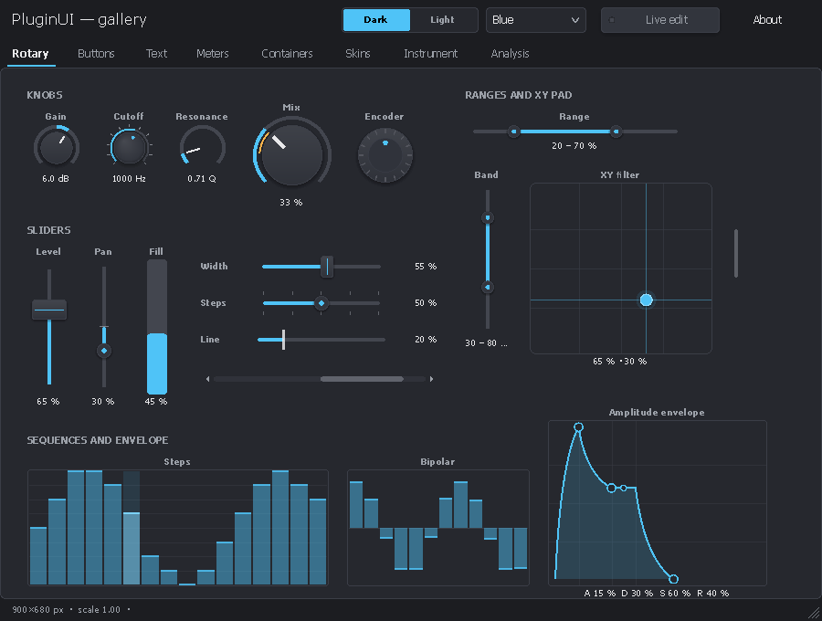
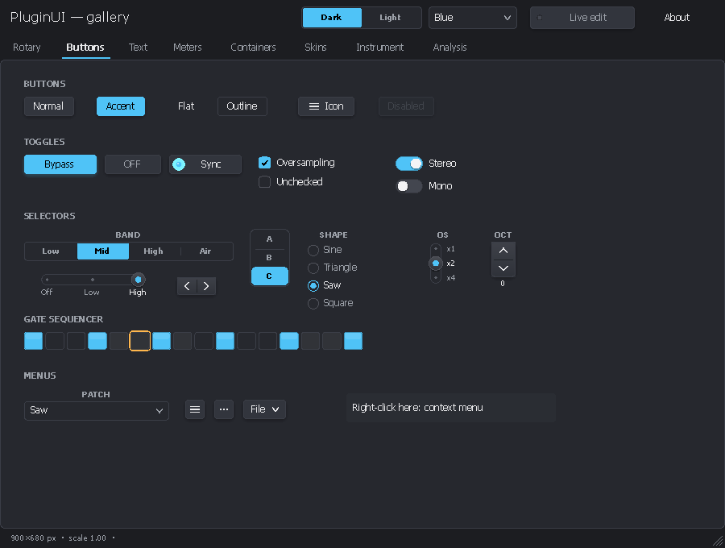
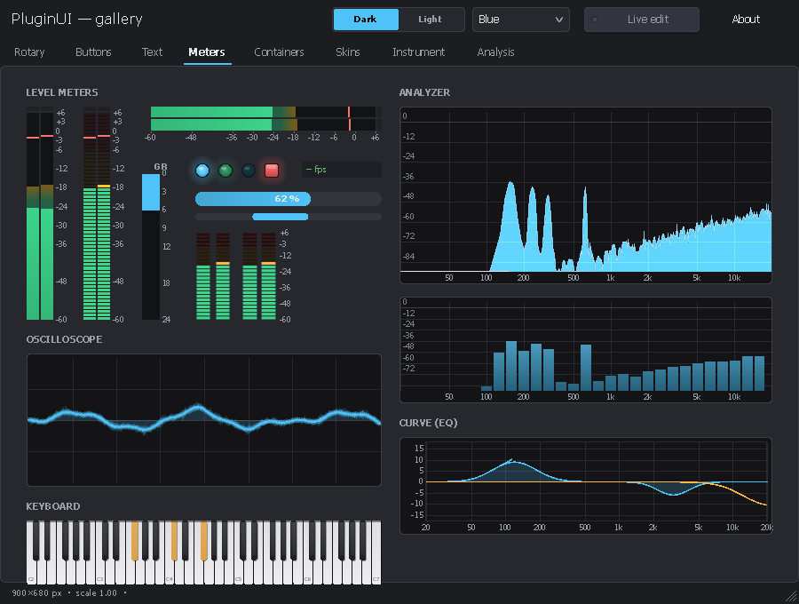
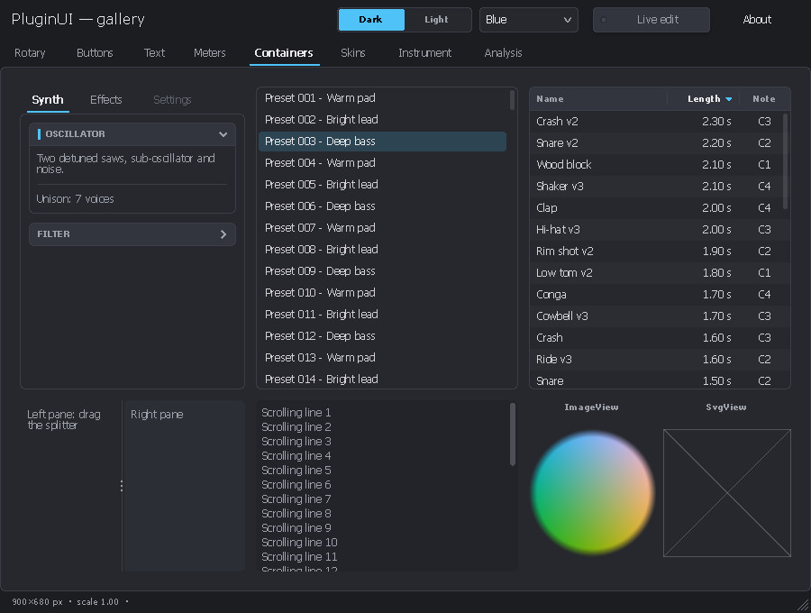
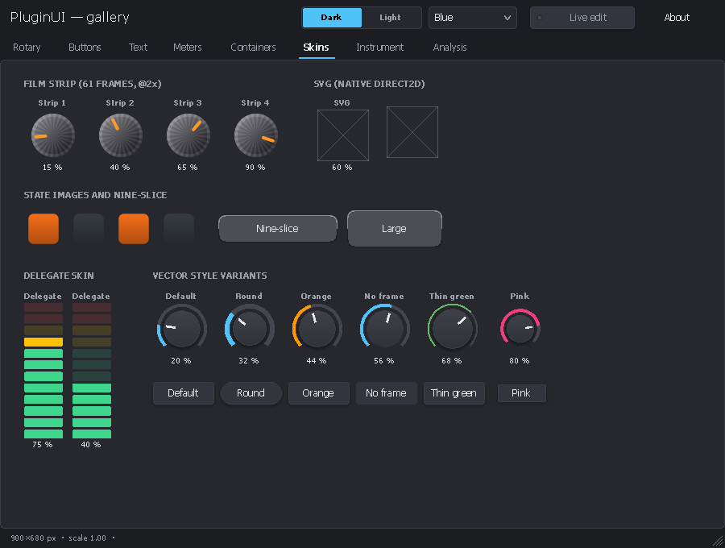
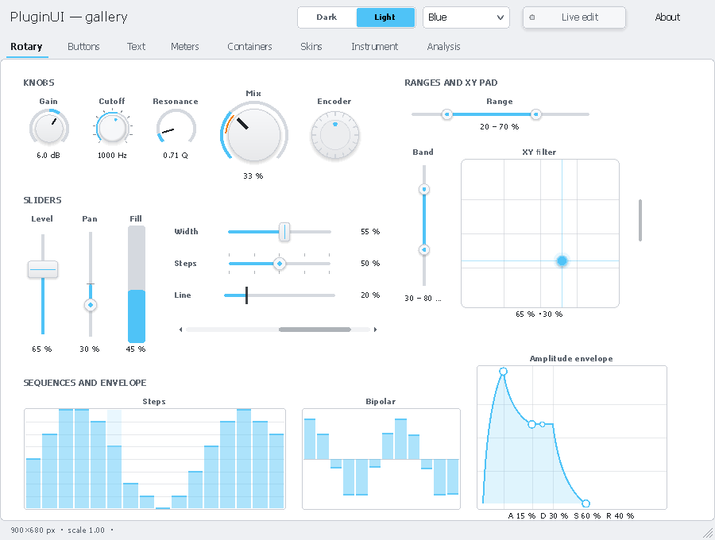
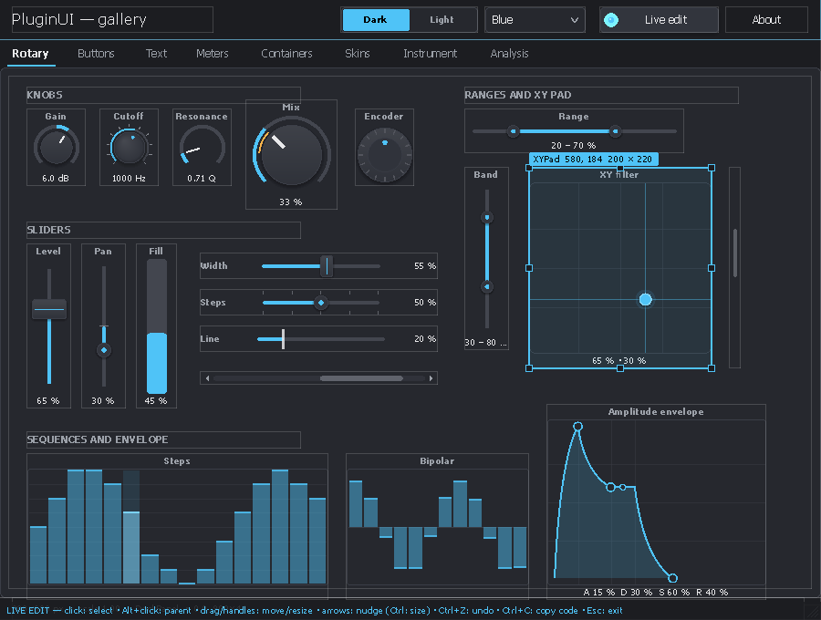
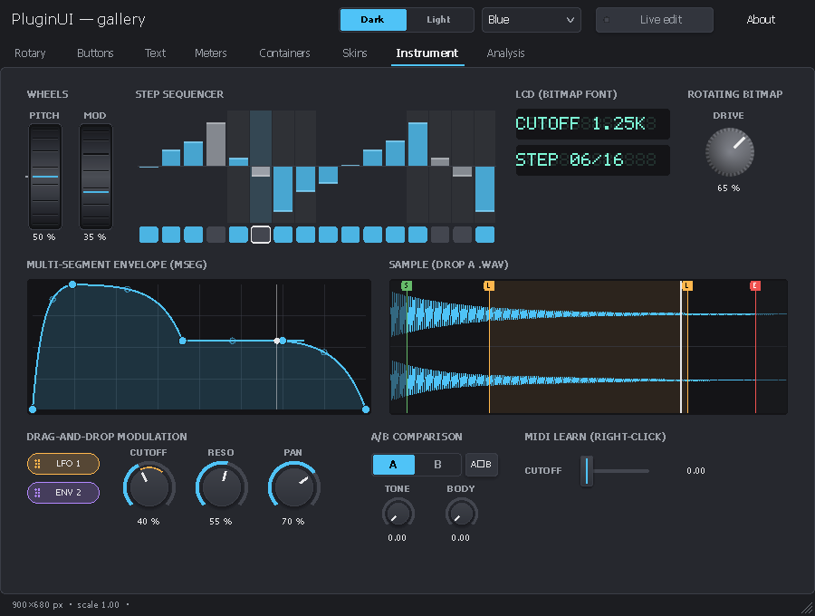
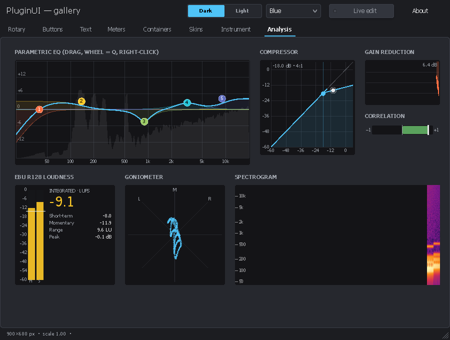
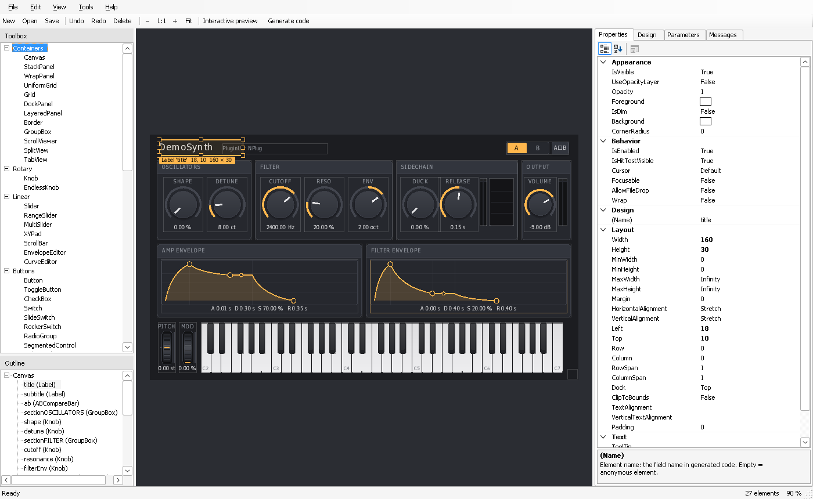

<!-- 2026/10/18 17:31:00 UTC - PluginUI -->

# PluginUI — Win32 + Direct2D user interface for audio plug-ins in C#

*Version française : [README_FR.md](README_FR.md)*

PluginUI is a user interface toolkit for VST3 plug-in editors written in C# / .NET 10. It draws everything with **Direct2D / DirectWrite** in **a single Win32 window, a child of the DAW's window**, has no dependency on WinForms, WPF or any UI runtime, and stays **NativeAOT-compatible** (the compiled plug-in is a native DLL that needs no installed .NET).

It brings together the element catalogs of **VSTGUI** and **iPlug2**, complemented by elements for instruments and for analysis (equalizer, EBU R128 loudness, spectrogram, waveform, MSEG, step sequencer, drag-and-drop modulation, MIDI learn, A/B): about eighty elements, each available as stylable vector drawing, as bitmap / film strip and as SVG. It also provides the extension points to create more.



| | |
|---|---|
|  |  |
|  |  |
|  |  |
|  |  |

*Screenshots produced by `PluginUI.Gallery --snapshot` (off-screen rendering). The crossed-out frames on the "Skins" and "Containers" pages are the SVGs, which the capture engine (Wine) cannot draw; Windows displays them natively.*

## Contents

```
PluginUI/
├── PluginUI.slnx
├── Directory.Build.props/.targets  Shared settings: NPlug location, package metadata, AVX2 instruction set for NativeAOT x64
├── CodeAnalysis.globalconfig       Enforced analysis rules (CA1304 / CA1305: no dependency on regional settings)
├── README.md, README_FR.md         This file (English, French)
├── LICENSE                         MIT license
├── CHANGELOG.md                    Version history
├── CONTRIBUTING.md, CONTRIBUTING_FR.md   How to contribute (English, French)
├── external/NPlug/                 Git submodule: NPlug fork with the fixes PluginUI needs (asm8086/NPlug, integration/pluginui)
├── build/                          Release script, VST3 loader (vst3shim) and validator tool
├── .github/workflows/              CI (Linux + Windows), documentation site, releases
├── docs/                           Each guide in English (X.md) and French (X_FR.md)
│   ├── CONTROLS.md                 Element catalog (with VSTGUI / iPlug2 equivalents)
│   ├── EXTENDING.md                Extending the library: themes, skins, controls, containers, popups
│   ├── EDITOR.md                   Guide to the PluginUIEditor visual designer and the .pluginui format
│   └── images/                     Screenshots (English; French ones in images/fr/)
├── docfx/                          Documentation site (DocFX): articles + API reference
├── src/
│   ├── PluginUI/                   The library (independent of any plug-in format)
│   │   ├── Primitives/             Point, Size, Rect, Thickness, Color (HSV, hexadecimal), InvariantNumber
│   │   ├── Rendering/              Direct2D renderer, DrawingContext, Paint (gradients), PathGeometry,
│   │   │                           TextStyle, ImageSource / FilmStrip / NineSlice (WIC), SvgImage
│   │   ├── Core/                   UIElement (layout, rendering, input), Panel, Control, ValueControl
│   │   ├── Layout/                 Canvas, StackPanel, Grid, WrapPanel, DockPanel, UniformGrid, Border
│   │   ├── Hosting/                UIHost (window, input, DPI, popups, timers), Popup, MenuPopup,
│   │   │                           LiveEditor, StandaloneWindow
│   │   ├── Parameters/             IParameter, LocalParameter (linear, logarithmic, power, lists)
│   │   ├── Localization/           UIStrings (interface texts in English / French), UILanguages
│   │   ├── Theming/                Theme, Palette, Typography, Metrics, VectorStyle
│   │   ├── Skins/                  Film strip, per-state images, SVG, nine-slice, delegate
│   │   ├── Animation/              Animator, Easing, ITickable
│   │   ├── Dsp/                    Fft, AudioRingBuffer, PeakValue, LevelBallistics, LoudnessAnalyzer (EBU R128),
│   │   │                           BiquadDesign, StereoAnalysis, CompressorMath, WavReader, WaveformPeaks, VectorOps (SIMD)
│   │   ├── Services/               Clipboard, native menus, file dialogs, shell, MIDI learn
│   │   └── Controls/               Rotary, Linear, Buttons, Menus, Text, Meters, Midi, Lists, Pickers, Misc
│   │                               (including equalizer, compressor, loudness, goniometer, spectrogram, waveform,
│   │                               MSEG, step sequencer, wheels, A/B, bitmap font, layers)
│   ├── PluginUI.NPlug/             NPlug (VST3) adapter: PluginEditorView, NPlugParameter, PluginUIController,
│   │                               PluginUIProcessor (notes from the editor, shared state), NPlugMidiLearn
│   └── PluginUI.Design/            .pluginui designs: document, JSON, AOT-compatible type registry, loader,
│                                   capture, C# code generation, themes, live design bridge, project creation
├── tools/PluginUIEditor/           WinForms visual designer (toolbox, properties, preview, code, new projects)
├── samples/PluginUI.Gallery/       Demo application (standalone window + PNG capture mode)
├── samples/PluginUI.DemoSynth/     Sample VST3 instrument: polyphonic synth with a sidechain input
├── samples/Designs/                Sample designs (.pluginui), including the DemoSynth layout
├── tests/PluginUI.Tests/           120 NUnit tests (layout, input, gestures, popups, controls, DSP and SIMD, cultures and languages, design conventions)
├── tests/PluginUI.NPlug.Tests/     22 NUnit tests (editor ↔ processor bridge, host keys, MIDI learn, synth DSP, Steinberg validator)
└── tests/PluginUI.Design.Tests/    25 NUnit tests (.pluginui format, loader, generated code compiled by Roslyn, live bridge, projects, editor commands, extensions)
```

About 34,000 lines of C# for the libraries. All public members have XML documentation.

## Requirements

- Windows 10 1809 (build 17763) or later, x64 or ARM64. Native SVG from 1703.
- Default NativeAOT publishing: a processor with AVX2 and FMA (see "Performance and SIMD").
- Visual Studio 2026, .NET 10 SDK.
- `TerraFX.Interop.Windows` 10.0.26100.6 (NuGet), for Win32 / Direct2D / DirectWrite / WIC bindings without marshalling, NativeAOT-compatible.
- `PluginUI.NPlug` only: the patched NPlug sources. By default the git submodule `external/NPlug` (fork [asm8086/NPlug](https://github.com/asm8086/NPlug), branch `integration/pluginui`; clone with `git clone --recurse-submodules`), otherwise the neighboring folder `..\NPlugCorrected`. To use another copy, set the MSBuild property `NPlugRoot` to that copy's `src\` folder. NuGet packages: `PluginUI` and `PluginUI.Design`; `PluginUI.NPlug` is used from source until the NPlug fixes it needs are released.

## Downloads

Each [release](https://github.com/asm8086/PluginUI/releases) provides:

| File | Content |
|---|---|
| `PluginUI.DemoSynth-<version>-vst3-universal.zip` | The demo instrument as one VST3 bundle for x64 and ARM64. On x64, a small loader picks the x86-64-v3 build (AVX2, FMA: Intel Haswell and later, AMD Zen and later) or the x86-64-v2 build (SSE4.2 and POPCNT: Intel Nehalem and later, AMD Bulldozer and later); on an older processor the plug-in declines to load instead of stopping the host |
| `…-vst3-x64-v3.zip`, `…-vst3-x64-v2.zip`, `…-vst3-arm64.zip` | One build per bundle, without loader |
| `PluginUIEditor-<version>-win-x64.zip`, `…-win-arm64.zip` | The visual designer (needs the .NET 10 Desktop Runtime) |
| `PluginUI.Gallery-<version>-win-x64.zip`, `…-win-arm64.zip` | The gallery, compiled with NativeAOT (no runtime needed) |
| `*.nupkg`, `SHA256SUMS.txt` | NuGet packages (also pushed to nuget.org once publishing is enabled) and checksums |

`build/Build-Release.ps1` builds the same files locally; see [CONTRIBUTING.md](CONTRIBUTING.md#releases).

## Quick start

### In an NPlug plug-in (VST3)

```csharp
// Controller: the beginEdit/performEdit/endEdit bridge is provided.
public sealed class MyController : PluginUIController<MyModel>
{
    [SupportedOSPlatform("windows10.0.17763")]
    protected override PluginEditorView CreateEditor() => new MyEditor(this);
}

// Editor: layout only.
[SupportedOSPlatform("windows10.0.17763")]
public sealed class MyEditor(MyController c) : PluginEditorView(c, new Size(480, 300), SizingMode.ScaleToFit)
{
    protected override UIElement Build()
    {
        var model = ((MyController)Sink).Model;
        var root = new Canvas();
        var gain = new Knob(Parameters[model.Gain]) { Label = "GAIN", ShowValueBubble = true };
        gain.SetBounds(20, 20, 72, 96);
        var meter = new LevelMeter { ChannelCount = 2 };
        meter.SetBounds(400, 20, 50, 200);
        root.Add(gain, meter, new CornerResizer { Left = 460, Top = 280, Width = 18, Height = 18 });
        return root;
    }
}
```

`PluginEditorView` handles the whole VST3 view protocol:

- `attached` / `removed` life cycle and child window;
- `setContentScaleFactor` or DPI detection;
- size negotiation: `canResize`, `checkSizeConstraint`, `resizeView` then `onSize`;
- mouse wheel and keys forwarded by the host;
- `findParameter`;
- the DAW's context menu on right-click over a bound control.

The keys the host forwards go to text fields and open menus; the others stay with the DAW (see `ForwardHostKeysToControls`).

### Instruments, notes, shared state and MIDI learn

`PluginUI.NPlug` also provides what an instrument (VSTi) needs:

- **Keyboard → processor**: `ConnectKeyboard(keyboard)` in the editor sends the notes played to the processor through a VST3 message. A processor derived from `PluginUIProcessor<TModel>` reads them without allocation in `ProcessMain` with `TryDequeueUINote`.
- **Shared state**: the processor returns an object from `CreateSharedState` (`PeakValue` peaks, `NoteActivity` notes, buffers); the controller receives it in `SharedState`, and the editor connects its meters and its keyboard to it (`PianoKeyboard.ActivitySource`).
- **MIDI learn**: with `IsMidiLearnEnabled = true`, the context menu of every bound control offers "MIDI Learn" and "Forget MIDI assignment", including in the DAW's menu. Assignments go through `IMidiMapping` and are saved with the controller state. Learning requires a host that implements `IMidiLearn` (Cubase, Nuendo…).
- **A/B comparison**: `ABCompareBar.Parameters = Parameters.GetSnapshotParameters()`.
- **Audio inputs on an instrument**: nothing prevents an instrument from having audio inputs, for example an auxiliary sidechain bus.

The `samples/PluginUI.DemoSynth` project puts all of this into practice (see its README).


### Standalone application

```csharp
StandaloneWindow.EnablePerMonitorDpiAwareness();
var host = new UIHost(root, new Size(640, 400), SizingMode.ScaleToFit);
return new StandaloneWindow(host, "My application").Run();
```

## Concepts

- **`UIHost`** owns the child window, the renderer, the layout, input routing (implicit capture, hover, focus, Tab, context menus, drag and drop, file drop), popups, tooltips, the value bubble, the animation timer and `Post` (run on the UI thread from another thread). It never runs a message loop: in a plug-in, the DAW's loop is used.
- **Coordinates**: everything is in DIPs (1/96 inch). `Bounds` is absolute within the host: no transforms to accumulate.
- **Layout** in two passes, as in WPF: `Measure` then `Arrange`, with `Width`/`Height`, minimum and maximum, `Margin` and alignments.
- **Sizing modes**:
  - `Fixed`: design size × DPI × `Zoom`;
  - `ScaleToFit`: proportional zoom of the drawing, resizable;
  - `Relayout`: the layout adapts to the size.
- **Parameters**: controls bind to an `IParameter` (normalized values 0–1, begin / perform / end gesture). Several gestures can be open at the same time, for example an XY pad with two parameters, or the mouse wheel on one control while another is being dragged.
- **Text entry and numbers**: on `Knob` and `Slider`, double-clicking the value text opens an entry box; elsewhere, it resets the value to its default. `TextEntryTriggers` chooses the triggers. Every number displayed or entered uses the decimal point, whatever the language and regional settings (`InvariantNumber`); a comma is rejected.
- **Language**: PluginUI's own texts (dialogs, preset menu, tooltips) follow `UIHost.Language`: *Auto* (the Windows language), English, French, or any language added with `UIStrings.Register`.
- **Rendering**: Direct2D resources are recreated after a device loss (`D2DERR_RECREATE_TARGET`), and bitmaps and SVGs are cached per host (`UIHost.EvictImage`). Opacity is applied as a global alpha, as in VSTGUI (`PushOpacityLayer` for true layer compositing). Arcs are Bézier curves.
- **Robustness**: no exception crosses the native boundary, whether in the window procedure, in timers or in posted actions (`UIHost.UnhandledException`). The window class has a unique name per module load and a reference count. Open gestures are closed if capture is lost, if the control leaves the tree or if the editor closes.

## Live edit mode

`Ctrl+Shift+E` in the editor open in the DAW:

- select, move and resize elements with the mouse or the keyboard;
- Ctrl+Z undoes;
- **Ctrl+C copies the corresponding C# code** (`SetBounds(...)` or `Margin`), to paste back into `Build()`.

Disable the shortcut in production with `host.LiveEditShortcutEnabled = false` (done in Release builds of the projects created by PluginUIEditor).

With a `LiveDesignBridge` (Debug builds of projects created by PluginUIEditor), **Ctrl+S** writes the layout back to the `.pluginui` file, and saving the design in PluginUIEditor rebuilds the editor in the DAW without reloading the plug-in.

## Visual designer: PluginUIEditor

`tools/PluginUIEditor` is a WinForms application for composing editors with the mouse: a toolbox with every element, a design surface rendered by PluginUI itself, a documented property grid, parameter bindings, undo / redo, clipboard, interactive preview, and an interface in English or French. A design is saved as `.pluginui` (JSON) and can be turned into reflection-free `.Designer.cs` code (NativeAOT), loaded at run time (`DesignLoader`), exported (PNG, theme, assets) or used as the starting point of a new effect, instrument or application project. Full guide: [docs/EDITOR.md](docs/EDITOR.md) ([français](docs/EDITOR_FR.md)).



## Performance and SIMD

`Directory.Build.targets` sets the instruction set for all projects in the folder:

- The libraries are AnyCPU (x64 and ARM64); the gallery, the editor and the plug-in build for the architecture of the build machine by default (`-r win-x64` or `-r win-arm64` to choose).
- With NativeAOT, `IlcInstructionSet` is `x86-64-v3` (AVX, AVX2, FMA, BMI1/2). Without this setting, AOT code is locked to the x64 baseline, with neither AVX nor FMA. To target processors without AVX2, publish with `-p:IlcInstructionSet=x86-64-v2`.
- With the JIT, nothing to set: the compiler uses whatever the processor offers.

The display DSP is vectorized with `Vector<T>`: 8 floats or 4 doubles per instruction with AVX2, 4 or 2 with SSE.

- **`Fft`**:
  - butterflies on separate real / imaginary arrays, with the bit-reversal permutation fused into the load;
  - `MagnitudeSpectrum` uses the real-signal algorithm (one complex FFT of N/2 points, then separation), which halves the work;
  - vectorized dB conversion (`Vector.Log`).
- **`AudioRingBuffer`**: copies in two contiguous segments (block copies) instead of one sample at a time with index masking; vectorized stereo averaging.
- **`PeakValue.PushBlockPeak`**, oscilloscope (min/max per column), analyzer (max per column): vectorized reductions.

Before / after measurements (median, NativeAOT `x86-64-v3`, 2-core virtual machine: indicative values):

| Operation | Before | After | Gain |
|---|---|---|---|
| Spectrum, 2048 points | 60 µs | 11 µs | × 5.3 |
| Spectrum, 8192 points | 317 µs | 87 µs | × 3.7 |
| Ring: write 512 samples (audio thread) | 0.30 µs | 0.03 µs | × 10 |
| Ring: copy the last 4096 (UI) | 2.6 µs | 0.14 µs | × 19 |
| Peak of a 512-sample block | 2.3 µs | 0.17 µs | × 14 |
| `Fft.Forward` (`Complex` API), 4096 points | 72 µs | 58 µs | × 1.3 |

The gain for `Forward` is smaller because the conversion between `Complex[]` and the separate arrays weighs heavily. The controls use only `MagnitudeSpectrum`.

Each SIMD kernel is checked against a scalar reference, or against the definition of the DFT for the FFT. To also cover the SSE-only and scalar paths:

```powershell
$env:DOTNET_EnableAVX = '0';        dotnet test tests/PluginUI.Tests; Remove-Item Env:DOTNET_EnableAVX
$env:DOTNET_EnableHWIntrinsic = '0'; dotnet test tests/PluginUI.Tests; Remove-Item Env:DOTNET_EnableHWIntrinsic
```

## Gallery

```
dotnet run --project samples/PluginUI.Gallery                       # interactive window
dotnet run --project samples/PluginUI.Gallery -- --snapshot out 2   # PNG captures at scale 2
```

The gallery shows the element families on eight pages, offers a dark or light theme and four accent colors, and includes live edit. It starts in English; `--lang fr` gives the French interface:

```
dotnet run --project samples/PluginUI.Gallery -- --lang fr                    # interactive window, in French
dotnet run --project samples/PluginUI.Gallery -- --snapshot out 2 --lang fr   # French PNG captures at scale 2
```

The French captures of this documentation are in `docs/images/fr/`. The gallery can also be published with NativeAOT: `dotnet publish -c Release -r win-x64 -p:PublishAot=true`.

## Documentation site

The API reference and the articles are built with [DocFX](https://dotnet.github.io/docfx/):

```
dotnet tool restore
dotnet docfx docfx/docfx.json --serve
```

The site is generated in `docfx/_site` and published on [GitHub Pages](https://asm8086.github.io/PluginUI/) by the documentation workflow. The API step builds `PluginUI.NPlug`, so the patched NPlug sources must be available (submodule, `..\NPlugCorrected` or `NPlugRoot`); a warning about `NPlug.Proxy.msbuildproj` is expected. The French guides are part of the site too, reachable from the language link at the top of each guide.

## Tests

```
dotnet test tests/PluginUI.Tests
dotnet test tests/PluginUI.NPlug.Tests
dotnet test tests/PluginUI.Design.Tests
```

The tests open no windows: they simulate input through `UIHost.Dispatch…`. They also run on Linux (continuous integration).

## Validation status

What was verified during development:

- the PluginUI projects build without warnings, with the NativeAOT and trimming analyzers enabled and warnings treated as errors;
- 120 unit tests, including the fr-FR / de-DE / en-US / ru-RU cultures, the interface language, the design conventions, and the SIMD kernels run with AVX2 / AVX-512, SSE only and scalar;
- 22 tests of the NPlug bridge and of DemoSynth (note queue, host key codes, typed values, MIDI learn and its persistence, envelopes, filter, oscillators, polyphony, sidechain);
- 25 tests of the designs and of the editor (JSON round trip of all default values and of unknown content, complete registry, loader, capture, generated code compiled by Roslyn and identical to the loader, including with hostile names and values, live bridge, generated projects, editor commands, extensions);
- Steinberg's official VST3 validator: 47/47 on DemoSynth (x86-64-v3, x86-64-v2, the universal bundle on x64 and on ARM64), and on the effect and instrument projects created by PluginUIEditor;
- PluginUIEditor run under Wine and driven by simulated mouse and keyboard events: drag and drop from the toolbox, selection, deletion, undo, keyboard moves, copy and paste, interactive preview, input in the property grid and in the parameter table, code generation, project creation (which builds), saving;
- Direct2D / DirectWrite / WIC rendering of every gallery page and of the DemoSynth editor, off-screen, under Wine;
- independent review of the core, with fixes: capture after a modal loop, gestures, DPI, clipboard, popup reentrancy.

What **could not be verified** during development, for lack of a real Windows machine, and remains to be confirmed:

- interactive behavior in a window (window procedure, mouse, keyboard, cursors, DPI changes) in a real DAW;
- native SVG rendering;
- PluginUIEditor's drop-down menus: under Wine, opening a menu of a WinForms application in PerMonitorV2 mode throws an exception inside WinForms (reproduced with a ten-line application), so the menus were tested through their keyboard shortcuts;
- the few effects Wine renders poorly: gradients to transparent, rounded clipping per layer.

Try the gallery first, then the DemoSynth plug-in (Reaper, Cubase, Bitwig…).

## License and contributing

PluginUI is released under the [MIT License](LICENSE) — Copyright (c) 2026 asm8086. NPlug is under the BSD-2-Clause license (Alexandre Mutel). Contributions are welcome: see [CONTRIBUTING.md](CONTRIBUTING.md) and the [CHANGELOG](CHANGELOG.md).
