<!-- 2026/10/19 07:48:00 UTC - PluginUI -->

# PluginUI — interface Win32 + Direct2D pour plugins audio en C#

*English version: [README.md](README.md)*

PluginUI est une boîte à outils d'interface utilisateur pour les éditeurs de plugins VST3 écrits en C# / .NET 10. Elle dessine tout en **Direct2D / DirectWrite** dans **une seule fenêtre Win32 enfant** de celle du DAW, n'a aucune dépendance à WinForms, WPF ou un runtime d'interface, et reste **compatible NativeAOT** (le plugin compilé est une DLL native sans .NET installé).

Elle réunit le catalogue d'éléments de **VSTGUI** et d'**iPlug2**, complété d'éléments pour instruments et pour l'analyse (égaliseur, sonie EBU R128, spectrogramme, forme d'onde, MSEG, séquenceur, modulation par glisser-déposer, apprentissage MIDI, A/B) : environ quatre-vingts éléments, chacun disponible en dessin vectoriel stylable, en bitmap / film-strip et en SVG. Elle offre aussi les points d'extension pour en créer d'autres.

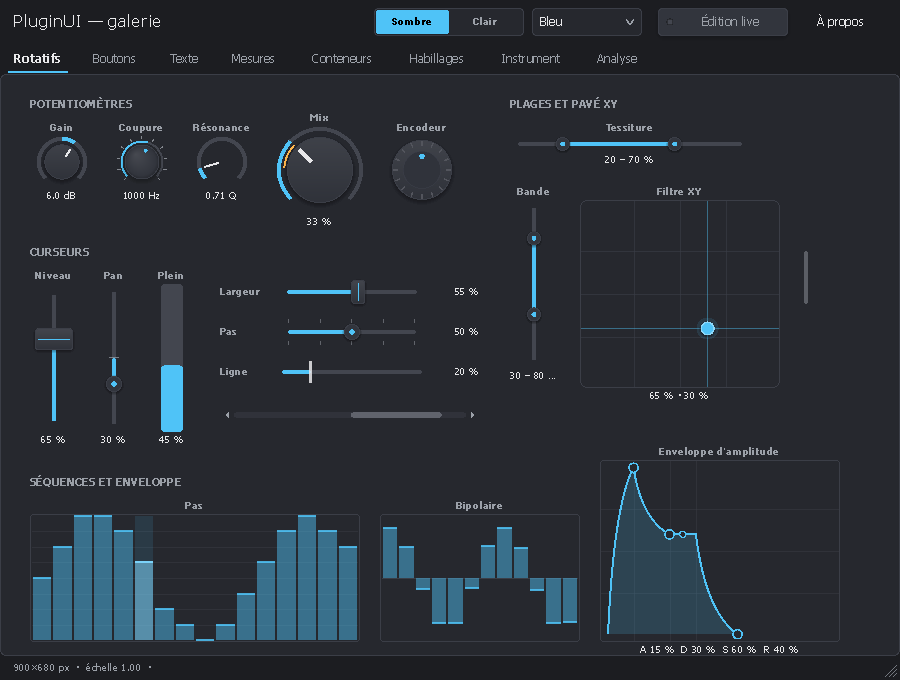

| | |
|---|---|
| 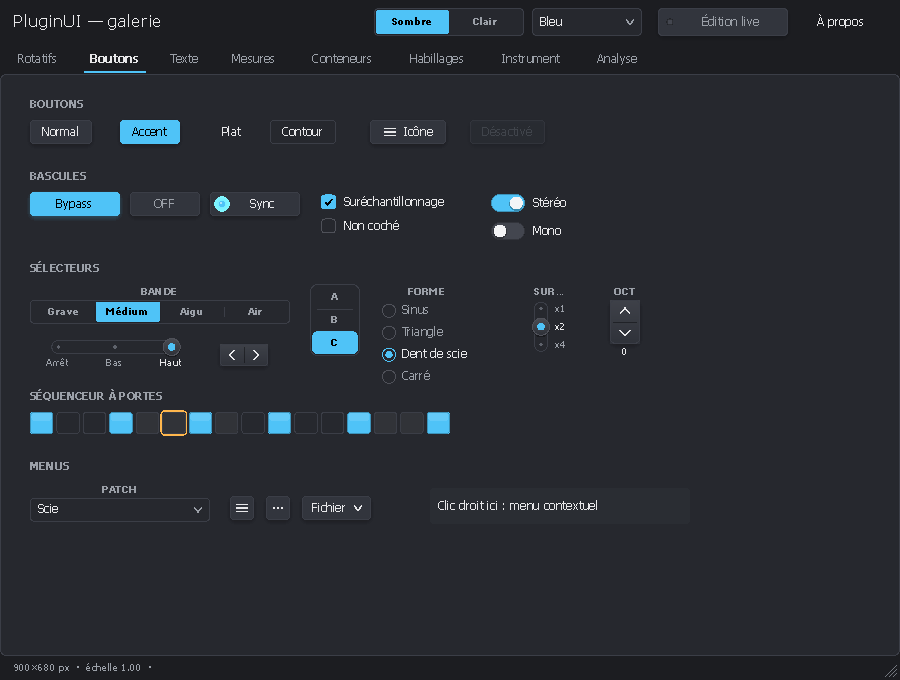 | 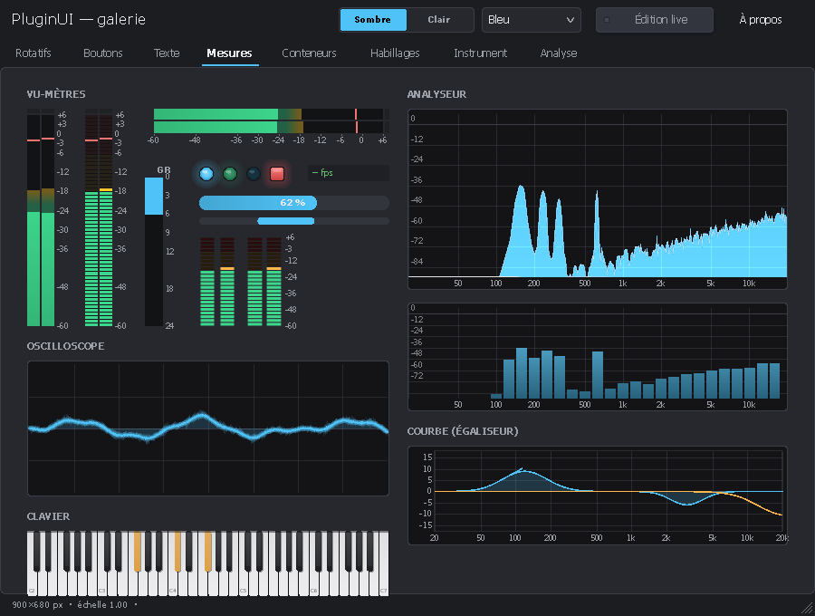 |
| 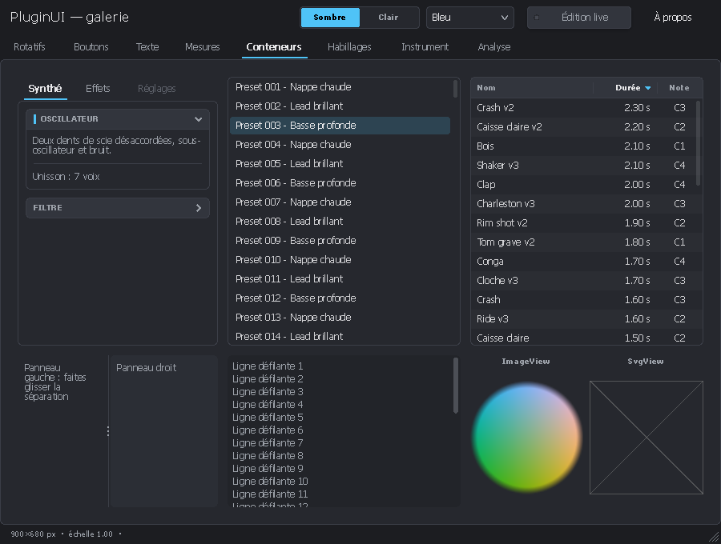 | 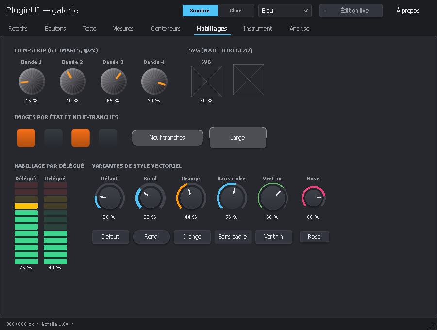 |
| 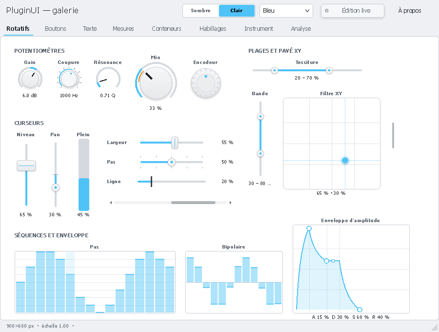 | 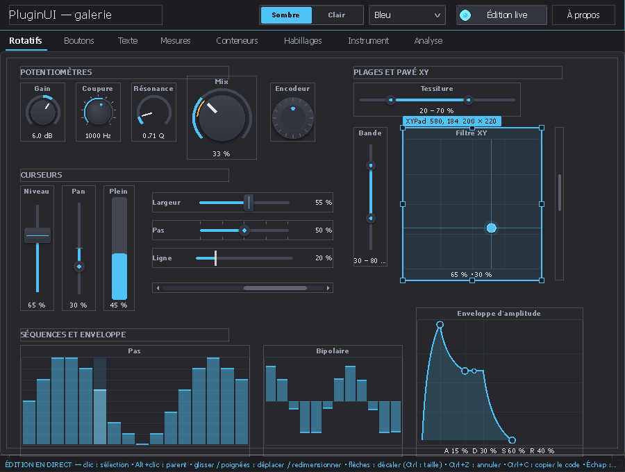 |
| 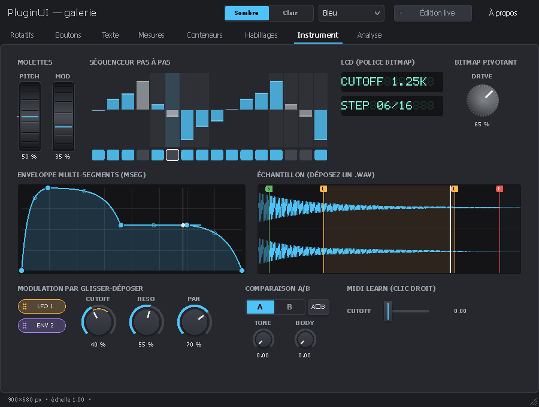 | 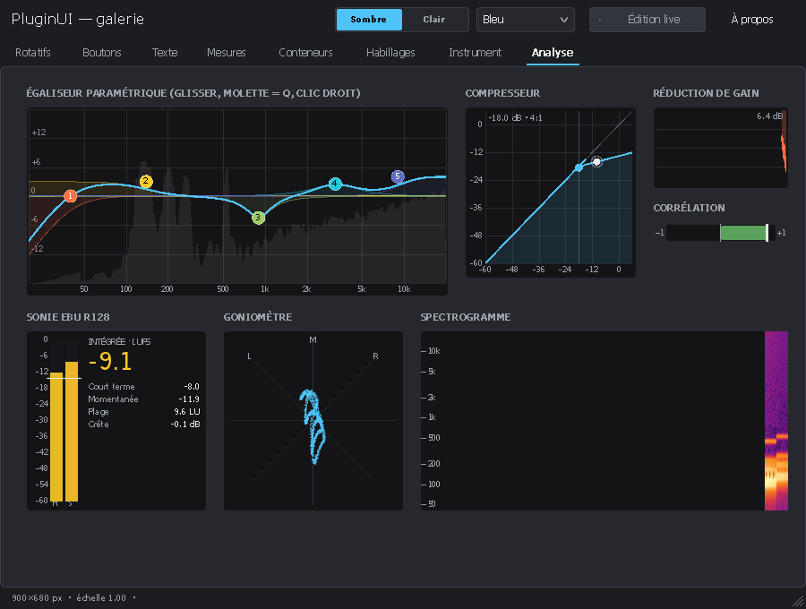 |

*Captures produites par `PluginUI.Gallery --snapshot` (rendu hors écran). Les cadres barrés des pages « Habillages » et « Conteneurs » sont les SVG, que le moteur de capture (Wine) ne sait pas dessiner ; Windows les affiche nativement.*

## Contenu

```
PluginUI/
├── PluginUI.slnx
├── Directory.Build.props/.targets  Réglages communs : emplacement de NPlug, métadonnées des paquets, jeu d'instructions AVX2 pour NativeAOT x64
├── CodeAnalysis.globalconfig       Règles d'analyse imposées (CA1304 / CA1305 : aucune dépendance aux paramètres régionaux)
├── README.md, README_FR.md         Ce fichier (anglais, français)
├── LICENSE                         Licence MIT
├── CHANGELOG.md                    Historique des versions
├── CONTRIBUTING.md, CONTRIBUTING_FR.md   Comment contribuer (anglais, français)
├── external/NPlug/                 Sous-module git : NPlug (xoofx/NPlug, étiquette 0.6.0)
├── build/                          Script de publication, chargeur VST3 (vst3shim) et outil de validation
├── .github/workflows/              Intégration continue (Linux + Windows), site de documentation, versions
├── docs/                           Chaque guide en anglais (X.md) et en français (X_FR.md)
│   ├── CONTROLS.md                 Catalogue des éléments (avec équivalents VSTGUI / iPlug2)
│   ├── EXTENDING.md                Étendre la bibliothèque : thèmes, habillages, contrôles, conteneurs, popups
│   ├── EDITOR.md                   Guide du concepteur visuel PluginUIEditor et du format .pluginui
│   └── images/                     Captures (anglais ; françaises dans images/fr/)
├── docfx/                          Site de documentation (DocFX) : articles + référence de l'API
├── src/
│   ├── PluginUI/                   La bibliothèque (indépendante de tout format de plugin)
│   │   ├── Primitives/             Point, Size, Rect, Thickness, Color (HSV, hexadécimal), InvariantNumber
│   │   ├── Rendering/              Renderer Direct2D, DrawingContext, Paint (dégradés), PathGeometry,
│   │   │                           TextStyle, ImageSource / FilmStrip / NineSlice (WIC), SvgImage
│   │   ├── Core/                   UIElement (mise en page, rendu, entrées), Panel, Control, ValueControl
│   │   ├── Layout/                 Canvas, StackPanel, Grid, WrapPanel, DockPanel, UniformGrid, Border
│   │   ├── Hosting/                UIHost (fenêtre, entrées, DPI, popups, minuteurs), Popup, MenuPopup,
│   │   │                           LiveEditor, StandaloneWindow
│   │   ├── Parameters/             IParameter, LocalParameter (lin., log., puissance, listes)
│   │   ├── Localization/           UIStrings (textes de l'interface en anglais / français), UILanguages
│   │   ├── Theming/                Theme, Palette, Typography, Metrics, VectorStyle
│   │   ├── Skins/                  Film-strip, images par état, SVG, neuf-tranches, délégué
│   │   ├── Animation/              Animator, Easing, ITickable
│   │   ├── Dsp/                    Fft, AudioRingBuffer, PeakValue, LevelBallistics, LoudnessAnalyzer (EBU R128),
│   │   │                           BiquadDesign, StereoAnalysis, CompressorMath, WavReader, WaveformPeaks, VectorOps (SIMD)
│   │   ├── Services/               Presse-papiers, menus natifs, dialogues de fichiers, shell, apprentissage MIDI
│   │   └── Controls/               Rotary, Linear, Buttons, Menus, Text, Meters, Midi, Lists, Pickers, Misc
│   │                               (dont égaliseur, compresseur, sonie, goniomètre, spectrogramme, forme d'onde,
│   │                               MSEG, séquenceur, molettes, A/B, police bitmap, calques)
│   ├── PluginUI.NPlug/             Adaptateur NPlug (VST3) : PluginEditorView, NPlugParameter, PluginUIController,
│   │                               PluginUIProcessor (notes de l'éditeur, état partagé), NPlugMidiLearn
│   └── PluginUI.Design/            Designs .pluginui : document, JSON, registre de types compatible AOT, chargeur,
│                                   capture, génération de code C#, thèmes, lien de design en direct, création de projets
├── tools/PluginUIEditor/           Concepteur visuel WinForms (boîte à outils, propriétés, aperçu, code, nouveaux projets)
├── samples/PluginUI.Gallery/       Application de démonstration (fenêtre autonome + mode capture PNG)
├── samples/PluginUI.DemoSynth/     Instrument VST3 d'exemple : synthé polyphonique avec entrée sidechain
├── samples/Designs/                Designs d'exemple (.pluginui), dont la disposition de DemoSynth
├── tests/PluginUI.Tests/           120 tests NUnit (mise en page, entrées, gestes, popups, contrôles, DSP et SIMD, cultures et langues, conventions de conception)
├── tests/PluginUI.NPlug.Tests/     22 tests NUnit (pont éditeur ↔ processeur, touches de l'hôte, MIDI learn, DSP du synthé, validateur Steinberg)
└── tests/PluginUI.Design.Tests/    25 tests NUnit (format .pluginui, chargeur, code généré compilé par Roslyn, lien en direct, projets, commandes de l'éditeur, extensions)
```

Environ 34 000 lignes de C# pour les bibliothèques. Tous les membres publics ont leur documentation XML.

## Prérequis

- Windows 10 1809 (build 17763) ou ultérieur, x64 ou ARM64. SVG natif à partir de 1703.
- Publication NativeAOT par défaut : processeur avec AVX2 et FMA (voir « Performances et SIMD »).
- Visual Studio 2026, SDK .NET 10.
- `TerraFX.Interop.Windows` 10.0.26100.6 (NuGet), pour des liaisons Win32 / Direct2D / DirectWrite / WIC sans marshalling, compatibles NativeAOT.
- `PluginUI.NPlug` uniquement : les sources de NPlug 0.6.0. Par défaut le sous-module git `external/NPlug` ([xoofx/NPlug](https://github.com/xoofx/NPlug), étiquette `0.6.0` ; clonez avec `git clone --recurse-submodules`), sinon un clone voisin `..\NPlug`. Pour en utiliser une autre copie, définissez la propriété MSBuild `NPlugRoot` sur son dossier `src\`. Paquets NuGet : `PluginUI` et `PluginUI.Design` ; `PluginUI.NPlug` s'utilise en sources tant que le paquet NuGet `NPlug.Proxy` ne place pas les plug-ins ARM64 dans `Contents\arm64-win` (la version 2.0.1 utilise encore `arm_64-win` ; les sources de NPlug 0.6.0 sont corrigées).

## Téléchargements

Chaque [version](https://github.com/asm8086/PluginUI/releases) fournit :

| Fichier | Contenu |
|---|---|
| `PluginUI.DemoSynth-<version>-vst3-universal.zip` | L'instrument de démonstration en un seul bundle VST3 pour x64 et ARM64. Sur x64, un petit chargeur choisit la version x86-64-v3 (AVX2, FMA : Intel Haswell et ultérieurs, AMD Zen et ultérieurs) ou la version x86-64-v2 (SSE4.2 et POPCNT : Intel Nehalem et ultérieurs, AMD Bulldozer et ultérieurs) ; sur un processeur plus ancien, le plugin refuse de se charger au lieu d'arrêter l'hôte |
| `…-vst3-x64-v3.zip`, `…-vst3-x64-v2.zip`, `…-vst3-arm64.zip` | Une seule version par bundle, sans chargeur |
| `PluginUIEditor-<version>-win-x64.zip`, `…-win-arm64.zip` | Le concepteur visuel (nécessite le .NET 10 Desktop Runtime) |
| `PluginUI.Gallery-<version>-win-x64.zip`, `…-win-arm64.zip` | La galerie, compilée en NativeAOT (aucun runtime nécessaire) |
| `*.nupkg`, `SHA256SUMS.txt` | Paquets NuGet (aussi poussés sur nuget.org une fois la publication activée) et sommes de contrôle |

`build/Build-Release.ps1` produit les mêmes fichiers en local ; voir [CONTRIBUTING_FR.md](CONTRIBUTING_FR.md#publication-des-versions).

## Démarrage rapide

### Dans un plugin NPlug (VST3)

```csharp
// Contrôleur : le pont beginEdit/performEdit/endEdit est fourni.
public sealed class MyController : PluginUIController<MyModel>
{
    [SupportedOSPlatform("windows10.0.17763")]
    protected override PluginEditorView CreateEditor() => new MyEditor(this);
}

// Éditeur : uniquement la mise en page.
[SupportedOSPlatform("windows10.0.17763")]
public sealed class MyEditor(MyController c) : PluginEditorView(c, new Size(480, 300), SizingMode.ScaleToFit)
{
    protected override UIElement Build()
    {
        var model = ((MyController)Sink).Model;
        var root = new Canvas();
        var gain = new Knob(Parameters[model.Gain]) { Label = "GAIN", ShowValueBubble = true };
        gain.SetBounds(20, 20, 72, 96);
        var meter = new LevelMeter { ChannelCount = 2 };
        meter.SetBounds(400, 20, 50, 200);
        root.Add(gain, meter, new CornerResizer { Left = 460, Top = 280, Width = 18, Height = 18 });
        return root;
    }
}
```

`PluginEditorView` gère tout le protocole de la vue VST3 :

- cycle de vie `attached` / `removed` et fenêtre enfant ;
- `setContentScaleFactor` ou détection du DPI ;
- négociation de taille : `canResize`, `checkSizeConstraint`, `resizeView` puis `onSize` ;
- molette et touches transmises par l'hôte ;
- `findParameter` ;
- menu contextuel du DAW au clic droit sur un contrôle lié.

Les touches que l'hôte transmet vont aux champs de texte et aux menus ouverts ; les autres restent au DAW (voir `ForwardHostKeysToControls`).

### Instruments, notes, état partagé et MIDI learn

`PluginUI.NPlug` fournit aussi ce qu'il faut pour un instrument (VSTi) :

- **Clavier → processeur** : `ConnectKeyboard(keyboard)` dans l'éditeur envoie les notes jouées au processeur par un message VST3. Un processeur dérivé de `PluginUIProcessor<TModel>` les lit sans allocation dans `ProcessMain` avec `TryDequeueUINote`.
- **État partagé** : le processeur renvoie un objet dans `CreateSharedState` (crêtes `PeakValue`, notes `NoteActivity`, tampons) ; le contrôleur le reçoit dans `SharedState`, et l'éditeur y branche ses vumètres et son clavier (`PianoKeyboard.ActivitySource`).
- **MIDI learn** : avec `IsMidiLearnEnabled = true`, le menu contextuel de chaque contrôle lié propose « Apprentissage MIDI » et « Oublier l'affectation MIDI », y compris dans le menu du DAW. Les affectations passent par `IMidiMapping` et sont enregistrées avec l'état du contrôleur. L'apprentissage demande un hôte qui implémente `IMidiLearn` (Cubase, Nuendo…).
- **Comparaison A/B** : `ABCompareBar.Parameters = Parameters.GetSnapshotParameters()`.
- **Entrées audio d'un instrument** : rien n'empêche un instrument d'avoir des entrées audio, par exemple un bus auxiliaire de sidechain.

Le projet `samples/PluginUI.DemoSynth` met tout cela en œuvre (voir son README).

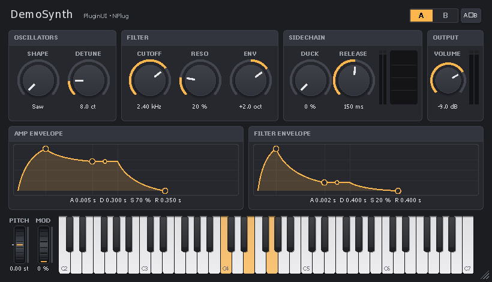

### Application autonome

```csharp
StandaloneWindow.EnablePerMonitorDpiAwareness();
var host = new UIHost(root, new Size(640, 400), SizingMode.ScaleToFit);
return new StandaloneWindow(host, "Mon application").Run();
```

## Concepts

- **`UIHost`** possède la fenêtre enfant, le moteur de rendu, la mise en page, le routage des entrées (capture implicite, survol, focus, Tab, menus contextuels, glisser-déposer, dépôt de fichiers), les popups, les infobulles, la bulle de valeur, le minuteur d'animation et `Post` (exécuter sur le thread d'interface depuis un autre thread). Il ne lance jamais de boucle de messages : dans un plugin, c'est celle du DAW.
- **Coordonnées** : tout est en DIP (1/96 pouce). `Bounds` est absolu dans l'hôte : pas de transformations à cumuler.
- **Mise en page** en deux passes, comme WPF : `Measure` puis `Arrange`, avec `Width`/`Height`, minimum et maximum, `Margin` et alignements.
- **Modes de taille** :
  - `Fixed` : taille de conception × DPI × `Zoom` ;
  - `ScaleToFit` : zoom proportionnel du dessin, redimensionnable ;
  - `Relayout` : la mise en page s'adapte à la taille.
- **Paramètres** : les contrôles se lient à un `IParameter` (valeurs normalisées 0–1, geste begin / perform / end). Plusieurs gestes peuvent être ouverts en même temps, par exemple un pavé XY avec deux paramètres, ou la molette sur un contrôle pendant qu'on en glisse un autre.
- **Saisie et nombres** : sur `Knob` et `Slider`, un double-clic sur le texte de la valeur ouvre une zone de saisie ; ailleurs, il remet la valeur par défaut. `TextEntryTriggers` choisit les déclencheurs. Tout nombre affiché ou saisi utilise le point décimal, quels que soient la langue et les paramètres régionaux (`InvariantNumber`) ; une virgule est refusée.
- **Langue** : les textes propres à PluginUI (dialogues, menu des presets, infobulles) suivent `UIHost.Language` : *Auto* (langue de Windows), anglais, français, ou toute langue ajoutée par `UIStrings.Register`.
- **Rendu** : les ressources Direct2D sont recréées après une perte de périphérique (`D2DERR_RECREATE_TARGET`), et les bitmaps et SVG sont mis en cache par hôte (`UIHost.EvictImage`). L'opacité est appliquée comme un alpha global, à la manière de VSTGUI (`PushOpacityLayer` pour une vraie composition par calque). Les arcs sont des courbes de Bézier.
- **Robustesse** : aucune exception ne traverse la frontière native, ni dans la procédure de fenêtre, ni dans les minuteurs, ni dans les actions postées (`UIHost.UnhandledException`). La classe de fenêtre a un nom unique par chargement du module et un compteur de références. Les gestes ouverts sont fermés si la capture est perdue, si le contrôle quitte l'arbre ou si l'éditeur se ferme.

## Mode d'édition en direct

`Ctrl+Maj+E` dans l'éditeur ouvert dans le DAW :

- sélection, déplacement et redimensionnement des éléments à la souris ou au clavier ;
- Ctrl+Z annule ;
- **Ctrl+C copie le code C#** correspondant (`SetBounds(...)` ou `Margin`), à recoller dans `Build()`.

Désactivez le raccourci en production avec `host.LiveEditShortcutEnabled = false` (fait dans les versions Release des projets créés par PluginUIEditor).

Avec un `LiveDesignBridge` (versions Debug des projets créés par PluginUIEditor), **Ctrl+S** réécrit la disposition dans le fichier `.pluginui`, et l'enregistrement du design dans PluginUIEditor reconstruit l'éditeur dans le DAW sans recharger le plugin.

## Concepteur visuel : PluginUIEditor

`tools/PluginUIEditor` est une application WinForms pour composer les éditeurs à la souris : boîte à outils de tous les éléments, surface de conception rendue par PluginUI lui-même, grille des propriétés documentée, liaisons aux paramètres, annuler / rétablir, presse-papiers, aperçu interactif, interface en anglais ou en français. Un design s'enregistre en `.pluginui` (JSON) et se transforme en code `.Designer.cs` sans réflexion (NativeAOT), se charge à l'exécution (`DesignLoader`), s'exporte (PNG, thème, ressources) ou sert de point de départ à un nouveau projet d'effet, d'instrument ou d'application. Guide complet : [docs/EDITOR_FR.md](docs/EDITOR_FR.md) ([English](docs/EDITOR.md)).

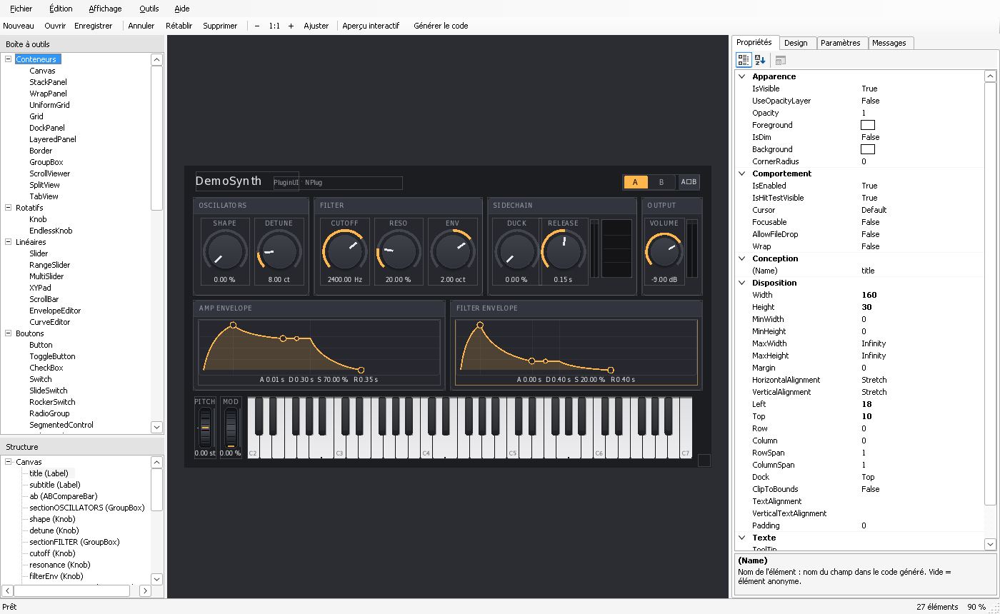

## Performances et SIMD

`Directory.Build.targets` fixe le jeu d'instructions pour tous les projets du dossier :

- Les bibliothèques sont AnyCPU (x64 et ARM64) ; la galerie, l'éditeur et le plugin compilent par défaut pour l'architecture de la machine (`-r win-x64` ou `-r win-arm64` pour choisir).
- En NativeAOT, `IlcInstructionSet` vaut `x86-64-v3` (AVX, AVX2, FMA, BMI1/2). Sans ce réglage, le code AOT est figé sur la base x64, sans AVX ni FMA. Pour viser des processeurs sans AVX2, publiez avec `-p:IlcInstructionSet=x86-64-v2`.
- En JIT, rien à régler : le compilateur utilise ce que le processeur offre.

Le DSP d'affichage est vectorisé avec `Vector<T>` : 8 floats ou 4 doubles par instruction avec AVX2, 4 ou 2 avec SSE.

- **`Fft`** :
  - papillons sur des tableaux réel / imaginaire séparés, avec la permutation par inversion de bits fusionnée au chargement ;
  - `MagnitudeSpectrum` utilise l'algorithme pour signal réel (une FFT complexe de N/2 points, puis séparation), ce qui divise le travail par deux ;
  - conversion en dB vectorisée (`Vector.Log`).
- **`AudioRingBuffer`** : copies en deux segments contigus (copies de blocs) au lieu d'un échantillon à la fois avec masquage d'indice ; moyenne stéréo vectorisée.
- **`PeakValue.PushBlockPeak`**, oscilloscope (min/max par colonne), analyseur (max par colonne) : réductions vectorisées.

Mesures avant / après (médiane, NativeAOT `x86-64-v3`, machine virtuelle de 2 cœurs : valeurs indicatives) :

| Opération | Avant | Après | Gain |
|---|---|---|---|
| Spectre, 2 048 points | 60 µs | 11 µs | × 5,3 |
| Spectre, 8 192 points | 317 µs | 87 µs | × 3,7 |
| Anneau : écriture de 512 échantillons (thread audio) | 0,30 µs | 0,03 µs | × 10 |
| Anneau : copie des 4 096 derniers (interface) | 2,6 µs | 0,14 µs | × 19 |
| Crête d'un bloc de 512 | 2,3 µs | 0,17 µs | × 14 |
| `Fft.Forward` (API `Complex`), 4 096 points | 72 µs | 58 µs | × 1,3 |

Le gain de `Forward` est plus faible parce que la conversion entre `Complex[]` et les tableaux séparés pèse lourd. Les contrôles n'utilisent que `MagnitudeSpectrum`.

Chaque noyau SIMD est vérifié contre une référence scalaire, ou contre la définition de la DFT pour la FFT. Pour couvrir aussi les chemins SSE seul et scalaire :

```powershell
$env:DOTNET_EnableAVX = '0';        dotnet test tests/PluginUI.Tests; Remove-Item Env:DOTNET_EnableAVX
$env:DOTNET_EnableHWIntrinsic = '0'; dotnet test tests/PluginUI.Tests; Remove-Item Env:DOTNET_EnableHWIntrinsic
```

## Galerie

```
dotnet run --project samples/PluginUI.Gallery                       # fenêtre interactive
dotnet run --project samples/PluginUI.Gallery -- --snapshot out 2   # captures PNG à l'échelle 2
```

La galerie montre les familles d'éléments sur huit pages, propose un thème sombre ou clair et quatre couleurs d'accent, et inclut l'édition en direct. Elle démarre en anglais ; `--lang fr` donne l'interface en français :

```
dotnet run --project samples/PluginUI.Gallery -- --lang fr                    # fenêtre interactive, en français
dotnet run --project samples/PluginUI.Gallery -- --snapshot out 2 --lang fr   # captures PNG françaises à l'échelle 2
```

Les captures françaises de cette documentation sont dans `docs/images/fr/`. La galerie se publie aussi en NativeAOT : `dotnet publish -c Release -r win-x64 -p:PublishAot=true`.

## Site de documentation

La référence de l'API et les articles sont générés avec [DocFX](https://dotnet.github.io/docfx/) :

```
dotnet tool restore
dotnet docfx docfx/docfx.json --serve
```

Le site est produit dans `docfx/_site` et publié sur [GitHub Pages](https://asm8086.github.io/PluginUI/) par le workflow de documentation. L'étape de l'API compile `PluginUI.NPlug` : les sources corrigées de NPlug doivent être disponibles (sous-module, `..\NPlugCorrected` ou `NPlugRoot`) ; un avertissement sur `NPlug.Proxy.msbuildproj` est normal. Les guides français font aussi partie du site, accessibles par le lien de langue en tête de chaque guide.

## Tests

```
dotnet test tests/PluginUI.Tests
dotnet test tests/PluginUI.NPlug.Tests
dotnet test tests/PluginUI.Design.Tests
```

Les tests n'ouvrent aucune fenêtre : ils simulent les entrées via `UIHost.Dispatch…`. Ils tournent aussi sous Linux (intégration continue).

## État de la validation

Ce qui a été vérifié pendant le développement :

- compilation des projets PluginUI sans avertissement, avec les analyseurs NativeAOT et trimming actifs et les avertissements traités comme des erreurs ;
- 120 tests unitaires, y compris les cultures fr-FR / de-DE / en-US / ru-RU, la langue de l'interface, les conventions de conception, et les noyaux SIMD exécutés avec AVX2 / AVX-512, SSE seul et en scalaire ;
- 22 tests du pont NPlug et de DemoSynth (file de notes, codes de touches de l'hôte, valeurs saisies, MIDI learn et sa persistance, enveloppes, filtre, oscillateurs, polyphonie, sidechain) ;
- 25 tests des designs et de l'éditeur (aller-retour JSON de toutes les valeurs par défaut et du contenu inconnu, registre complet, chargeur, capture, code généré compilé par Roslyn et identique au chargeur, y compris avec des noms et valeurs hostiles, lien en direct, projets générés, commandes de l'éditeur, extensions) ;
- validateur VST3 officiel de Steinberg : 47/47 sur DemoSynth (x86-64-v3, x86-64-v2, bundle universel sur x64 et sur ARM64), et sur les projets d'effet et d'instrument créés par PluginUIEditor ;
- PluginUIEditor exécuté sous Wine et piloté par des événements souris et clavier simulés : glisser-déposer depuis la boîte à outils, sélection, suppression, annuler, déplacement au clavier, copier-coller, aperçu interactif, saisie dans la grille des propriétés et dans le tableau des paramètres, génération de code, création de projet (qui compile), enregistrement ;
- rendu Direct2D / DirectWrite / WIC de toutes les pages de la galerie et de l'éditeur de DemoSynth, hors écran, sous Wine ;
- relecture indépendante du cœur, avec corrections : capture après une boucle modale, gestes, DPI, presse-papiers, réentrance des popups.

Ce qui **n'a pas pu l'être** pendant le développement, faute de Windows réel, et reste à confirmer :

- le comportement interactif dans une fenêtre (procédure de fenêtre, souris, clavier, curseurs, changements de DPI) dans un vrai DAW ;
- le rendu SVG natif ;
- les menus déroulants de PluginUIEditor : sous Wine, ouvrir un menu d'une application WinForms en mode PerMonitorV2 lève une exception dans WinForms (reproduit avec une application de dix lignes), les menus ont donc été testés par leurs raccourcis clavier ;
- les quelques effets que Wine rend mal : dégradés vers le transparent, découpes arrondies par calque.

Faites d'abord un essai dans la galerie, puis dans le plugin DemoSynth (Reaper, Cubase, Bitwig…).

## Licence et contributions

PluginUI est publié sous [licence MIT](LICENSE) — Copyright (c) 2026 asm8086. NPlug est sous licence BSD-2-Clause (Alexandre Mutel). Les contributions sont les bienvenues : voir [CONTRIBUTING_FR.md](CONTRIBUTING_FR.md) et le [CHANGELOG](CHANGELOG.md).
