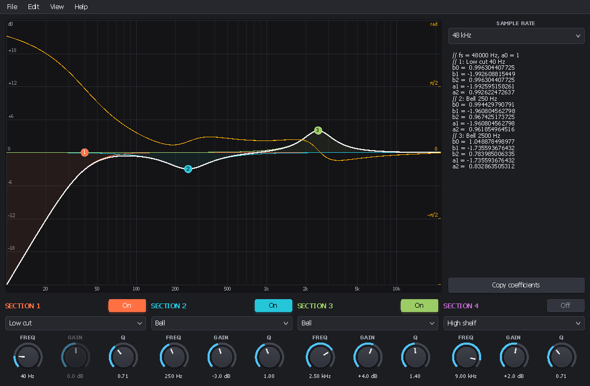
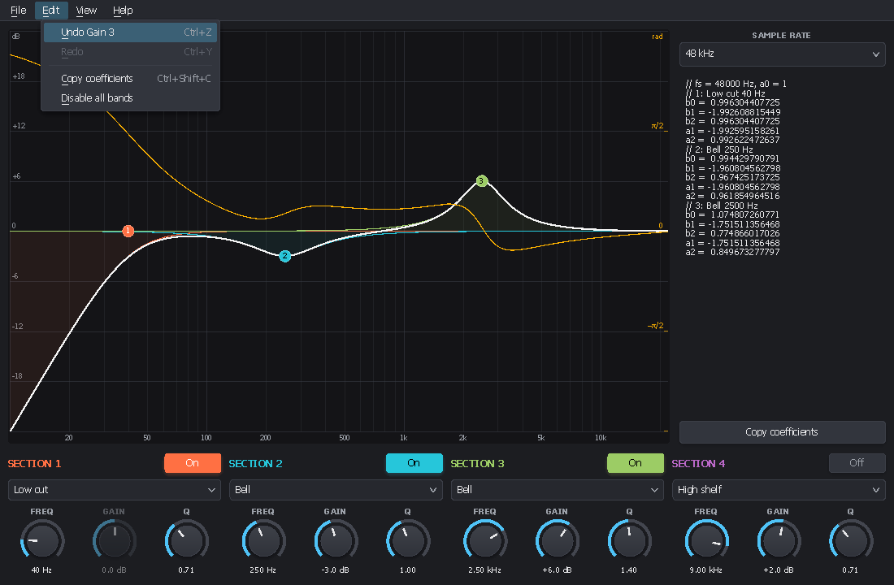
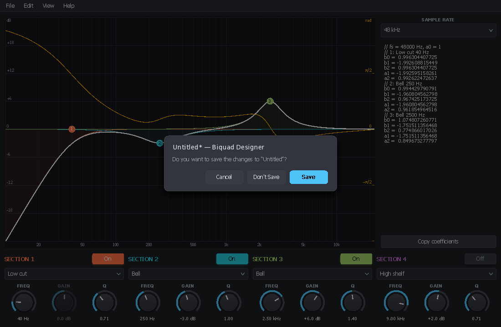

<!-- 2026/11/05 14:06:00 UTC - PluginUI -->

# Desktop applications with PluginUI

*[Français](DESKTOP_FR.md)*

PluginUI draws the editors of audio plug-ins inside a window that the host gives it. The same elements can also be the
**whole interface of a Windows application**: a filter designer, a sample editor, a test bench, the standalone version
of a plug-in. The application is compiled at your choice:

| Mode | Command | Result |
|---|---|---|
| IL (JIT) | `dotnet run`, F5 in Visual Studio, `dotnet publish -c Release` | Debuggable; needs the .NET 10 runtime (or `-p:SelfContained=true`) |
| NativeAOT | `dotnet publish -c Release -p:PublishAot=true` | One native `.exe`, fast start, no runtime to install |

The code is the same in both modes: PluginUI and PluginUI.Desktop are NativeAOT compatible (no reflection, JSON through
source generation), and the analyzers turn any incompatibility into a build error (`<IsAotCompatible>true</IsAotCompatible>`).



## What goes where

| Piece | Package | Role |
|---|---|---|
| `StandaloneWindow` | PluginUI | Top-level window: DPI, resizing, message loop, `ShowDialog` (modal), dark title bar, icon, saved placement |
| `MenuBar` | PluginUI | Drawn menu bar: click, Alt+letter, lone Alt or F10, arrows, hover between menus, shortcuts of every entry |
| `Command`, `KeyGesture`, `CommandSet` | PluginUI | Actions with a label, a shortcut, an enabled and a checked state, shared by menus and the keyboard |
| `Mnemonics` | PluginUI | `&` markers of menu texts ("&File", "Save &As…", "R&&D") |
| `DesktopApplication` | PluginUI.Desktop | DPI awareness, data folder, main window placement, recent files, commands, loop, crash report |
| `DocumentSession` | PluginUI.Desktop | File path, modified state, title bar, New / Open / Save / Save As, "save changes?", recent files |
| `UndoStack` | PluginUI.Desktop | Undo / redo with merging of drags, saved point, ready-made Ctrl+Z / Ctrl+Y commands, parameter tracking |
| `AppSettings<T>` | PluginUI.Desktop | Settings in one JSON file, through System.Text.Json source generation |
| `RecentFiles` | PluginUI.Desktop | Most recently used files and the File / Recent Files sub-menu |
| `MessageDialog` | PluginUI.Desktop | Synchronous message boxes and the Save / Don't Save / Cancel question, drawn by PluginUI |

The menu bar, the commands and the modal windows are in the core library because a plug-in can use them too (a
standalone build, a settings window). Keep `MenuBar.HandlesAltKey = false` in a plug-in editor: the DAW owns Alt and F10.

## A minimal application

```xml
<Project Sdk="Microsoft.NET.Sdk">
  <PropertyGroup>
    <OutputType>WinExe</OutputType>
    <TargetFramework>net10.0</TargetFramework>
    <SupportedOSPlatformVersion>10.0.17763.0</SupportedOSPlatformVersion>
    <RuntimeIdentifier>win-x64</RuntimeIdentifier>
    <ApplicationIcon>app.ico</ApplicationIcon>
    <ApplicationManifest>app.manifest</ApplicationManifest>
    <IsAotCompatible>true</IsAotCompatible>
    <Nullable>enable</Nullable>
    <ImplicitUsings>enable</ImplicitUsings>
  </PropertyGroup>
  <ItemGroup>
    <PackageReference Include="PluginUI.Desktop" Version="*" />
  </ItemGroup>
</Project>
```

```csharp
using PluginUI;
using PluginUI.Desktop;

internal static class Program
{
    [STAThread] // required: file dialogs, clipboard and drag and drop are COM / OLE services
    private static int Main()
    {
        var app = new DesktopApplication("My Tool", company: "Me");   // %APPDATA%\Me\My Tool
        var t = UIStrings.ForLanguage(UIHost.DefaultLanguage);

        var file = new MenuItem(t.MenuFile);
        file.Items.Add(new MenuItem(t.MenuExit, app.Exit) { ShortcutText = "Alt+F4" });
        var bar = new MenuBar(file) { Dock = Side.Top };

        var root = new DockPanel();
        root.Children.Add(bar);
        root.Children.Add(new Label("Hello"));

        var host = new UIHost(root, new Size(800, 500), SizingMode.Relayout) { MinSize = new Size(400, 300) };
        return app.Run(new StandaloneWindow(host, app.Name));
    }
}
```

`[STAThread]` is mandatory: without it the common file dialogs misbehave or hang (the constructor of
`DesktopApplication` throws an explicit error). Top-level statements cannot carry the attribute, hence the explicit
`Main`.

`app.Run` restores the saved position and size of the window (on a monitor that still exists), routes `app.Commands`
from the keyboard, runs the message loop, then saves `state.json` (placement, recent files) in the data folder.

## Menus, commands and shortcuts

A `Command` is an action with its label, shortcut and state. A `MenuItem` built from a command shows them as they are
when the menu opens: no code to keep the menus in sync.

```csharp
var showGrid = new Command("Show &grid", () => grid = !grid, KeyGesture.Parse("Ctrl+G"))
{
    IsCheckedWhen = () => grid,                 // check mark
};
var delete = new Command("&Delete", DeleteSelection, KeyGesture.Parse("Del"))
{
    CanExecuteWhen = () => selection.Count > 0, // greyed out otherwise; the key then goes to the focused element
};
view.Items.Add(new MenuItem(showGrid));
edit.Items.Add(new MenuItem(delete));
```

- **Shortcuts.** The menu bar runs the shortcut of any entry of its menus, sub-menus included: the command's
  `Gesture` (plus `AlternateGestures`), or for a plain entry its `ShortcutText` when it can be parsed ("Ctrl+O",
  "F1"). Commands that are not in a menu go into a `CommandSet` (`app.Commands`, or `new CommandSet().Attach(host)`).
  A shortcut does not repeat while the key is held, unless `AllowsRepeat` (Undo, Redo, Zoom).
- **Gestures.** `KeyGesture.Parse` reads "Ctrl+Shift+S", "Alt+F4", "Ctrl++", "Del", "F5", also with French names
  ("Maj+Suppr"). Menus display them in the interface language (Ctrl+Maj+S in French).
- **Mnemonics.** `&` before a letter underlines it (shown after Alt, F10 or a menu opened from the keyboard);
  `&&` writes a `&`. Escape user data (file names, preset names) with `Mnemonics.Escape`.
- **Keyboard.** Alt+letter opens a menu; a lone Alt or F10 selects the first title (Left / Right move, Down / Enter
  open, Escape leaves); in a menu, a letter runs the only entry with that mnemonic, or moves among several; Left and
  Right go to the neighbouring menus. With the mouse: click a title, then hover the others.
- **Dynamic menus.** Rebuild entries in `MenuBar.Opening` (recent files, window list).

## Documents, undo and recent files

`DocumentSession` drives a single-document application. Give it three functions and use its commands:

```csharp
var doc = new DocumentSession(window, app, [new FileFilter("My documents", "*.mydoc")], "mydoc")
{
    Reset = model.Reset,               // New
    Read = path => model.Load(path),   // Open (return false or throw on error: a message is shown)
    Write = path => model.Save(path),  // Save, Save As
};
file.Items.Add(new MenuItem(doc.NewCommand));      // Ctrl+N
file.Items.Add(new MenuItem(doc.OpenCommand));     // Ctrl+O
file.Items.Add(new MenuItem(doc.SaveCommand));     // Ctrl+S
file.Items.Add(new MenuItem(doc.SaveAsCommand));   // Ctrl+Shift+S
edit.Items.Add(new MenuItem(doc.Undo.UndoCommand)); // Ctrl+Z, "Undo Gain"
edit.Items.Add(new MenuItem(doc.Undo.RedoCommand)); // Ctrl+Y and Ctrl+Shift+Z
```

The title bar shows "Name* — Application" while the document is modified. New, Open and closing the window ask
"Do you want to save the changes?" (Save / Don't Save / Cancel). Opened and saved files go into the recent files;
fill the sub-menu with `app.RecentFiles.FillMenu(recentMenu, path => doc.OpenFile(path))` in `MenuBar.Opening`.

The document is modified when its undo history differs from the saved point. Record changes in `doc.Undo`:

- `Undo.Track(parameter)` records the user edits of a `LocalParameter`: one step per gesture (a knob drag, a node
  dragged in a graph, a wheel burst), named after the parameter.
- `Undo.Do(name, redo, undo, mergeKey)` runs and records a change of your model; consecutive steps with the same
  `mergeKey` merge until `EndMerge()` (the end of a drag).
- `doc.MarkDirty()` marks a change that cannot be undone.

## Settings

```csharp
public sealed class MySettings { public bool ShowGrid { get; set; } = true; public string Language { get; set; } = "auto"; }

[JsonSerializable(typeof(MySettings))]
[JsonSourceGenerationOptions(WriteIndented = true)]
internal sealed partial class MyJson : JsonSerializerContext;

var settings = AppSettings<MySettings>.Load(app.GetDataPath("settings.json"), MyJson.Default.MySettings);
settings.Value.ShowGrid = false;
settings.Save(); // temporary file then replace: never a truncated file
```

A missing file gives the defaults; an unreadable one too, and it is kept as `settings.json.bad`.

## Windows and dialogs

- `StandaloneWindow.ShowDialog(owner)` shows a modal window: the owner is disabled and a nested loop runs until the
  dialog closes; `Close(result)` sets the returned `DialogResult`. `StartPosition` centres it on its owner by default.
- `MessageDialog.Show(window, title, text, MessageBoxButtons.YesNo)` and `MessageDialog.AskSaveChanges` draw the
  question inside the window (same look as the rest of the interface) and return the answer.
- `Closing` (cancelable) and `RequestClose()` (like the close button) let the application refuse to quit.
- `DarkTitleBar` follows the theme of the host (dark background → dark title bar); call `UpdateTitleBarTheme()` after
  changing theme. `IconPath` or the project's `<ApplicationIcon>` gives the title bar and taskbar icon.
- `Placement` gets or sets the restored bounds and the maximized state (saved by `DesktopApplication`).

## Example: Biquad Designer

`samples/PluginUI.DesktopDemo` designs a cascade of four RBJ biquads: drag the points of the response (wheel = Q), one
column of controls per section, coefficients ready to copy, files `.bqd` (JSON), undo / redo of every edit, recent
files, phase curve, light theme and French interface (View menu). See its [README](../samples/PluginUI.DesktopDemo/README.md).

```
dotnet run --project samples/PluginUI.DesktopDemo                                      # IL, with the debugger
dotnet publish samples/PluginUI.DesktopDemo -c Release -r win-x64 -p:PublishAot=true   # NativeAOT
```




