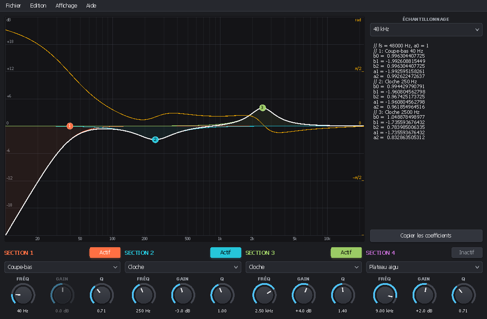
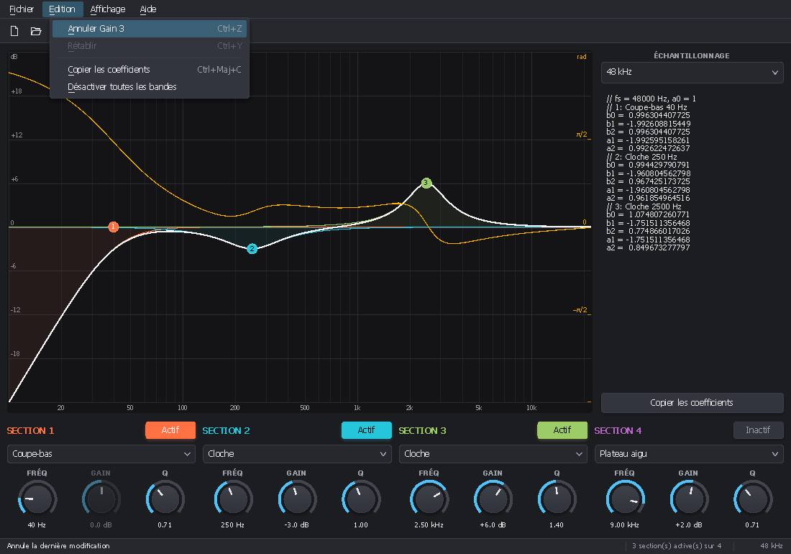
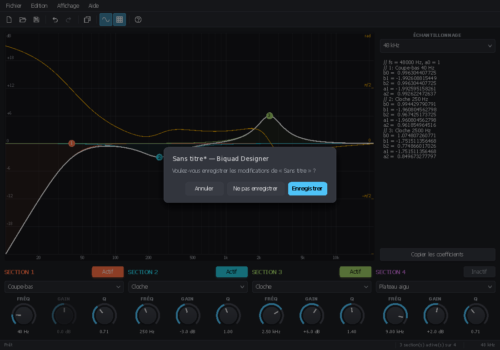

<!-- 2026/11/06 02:49:00 UTC - PluginUI -->

# Applications de bureau avec PluginUI

*[English](DESKTOP.md)*

PluginUI dessine les éditeurs de plugins audio dans une fenêtre fournie par l'hôte. Les mêmes éléments peuvent aussi
constituer **l'interface complète d'une application Windows** : concepteur de filtres, éditeur d'échantillons, banc
d'essai, version autonome d'un plugin. L'application se compile au choix :

| Mode | Commande | Résultat |
|---|---|---|
| IL (JIT) | `dotnet run`, F5 dans Visual Studio, `dotnet publish -c Release` | Débogable ; nécessite le runtime .NET 10 (ou `-p:SelfContained=true`) |
| NativeAOT | `dotnet publish -c Release -p:PublishAot=true` | Un seul `.exe` natif, démarrage rapide, aucun runtime à installer |

Le code est le même dans les deux modes : PluginUI et PluginUI.Desktop sont compatibles NativeAOT (pas de réflexion,
JSON par génération de source) et les analyseurs transforment toute incompatibilité en erreur de compilation
(`<IsAotCompatible>true</IsAotCompatible>`).



## Qui fait quoi

| Élément | Paquet | Rôle |
|---|---|---|
| `StandaloneWindow` | PluginUI | Fenêtre principale : DPI, redimensionnement, boucle de messages, `ShowDialog` (modal), barre de titre sombre, icône, position mémorisée |
| `MenuBar` | PluginUI | Barre de menus dessinée : clic, Alt+lettre, Alt seul ou F10, flèches, survol d'un menu à l'autre, raccourcis de toutes les entrées |
| `ToolBar`, `ToolGlyph` | PluginUI | Rangée de boutons construits à partir des mêmes commandes que les menus, avec 18 icônes vectorielles |
| `StatusBar` | PluginUI | Champs en bas de la fenêtre, descriptions des entrées survolées, messages temporaires |
| `Command`, `KeyGesture`, `CommandSet` | PluginUI | Actions avec libellé, raccourci, état actif et coché, partagées par les menus et le clavier |
| `Mnemonics` | PluginUI | Marqueurs `&` des textes de menu (« &Fichier », « Enregistrer &sous… », « R&&D ») |
| `DesktopApplication` | PluginUI.Desktop | DPI, dossier de données, position de la fenêtre, fichiers récents, commandes, boucle, rapport de plantage |
| `DocumentSession` | PluginUI.Desktop | Chemin, état modifié, barre de titre, Nouveau / Ouvrir / Enregistrer / Enregistrer sous, « enregistrer les modifications ? », fichiers récents |
| `UndoStack` | PluginUI.Desktop | Annuler / rétablir avec fusion des glissés, point d'enregistrement, commandes Ctrl+Z / Ctrl+Y prêtes, suivi des paramètres |
| `AppSettings<T>` | PluginUI.Desktop | Réglages dans un fichier JSON, par génération de source System.Text.Json |
| `RecentFiles` | PluginUI.Desktop | Fichiers récents et sous-menu Fichier / Fichiers récents |
| `MessageDialog` | PluginUI.Desktop | Boîtes de message synchrones et question Enregistrer / Ne pas enregistrer / Annuler, dessinées par PluginUI |

La barre de menus, les commandes et les fenêtres modales sont dans la bibliothèque de base parce qu'un plugin peut aussi
s'en servir (version autonome, fenêtre de réglages). Gardez `MenuBar.HandlesAltKey = false` dans un éditeur de plugin :
Alt et F10 appartiennent au DAW.

## Une application minimale

```xml
<Project Sdk="Microsoft.NET.Sdk">
  <PropertyGroup>
    <OutputType>WinExe</OutputType>
    <TargetFramework>net10.0</TargetFramework>
    <SupportedOSPlatformVersion>10.0.17763.0</SupportedOSPlatformVersion>
    <RuntimeIdentifier>win-x64</RuntimeIdentifier>
    <ApplicationIcon>app.ico</ApplicationIcon>
    <ApplicationManifest>app.manifest</ApplicationManifest>
    <IsAotCompatible>true</IsAotCompatible>
    <Nullable>enable</Nullable>
    <ImplicitUsings>enable</ImplicitUsings>
  </PropertyGroup>
  <ItemGroup>
    <PackageReference Include="PluginUI.Desktop" Version="*" />
  </ItemGroup>
</Project>
```

```csharp
using PluginUI;
using PluginUI.Desktop;

internal static class Program
{
    [STAThread] // obligatoire : dialogues de fichiers, presse-papiers et glisser-déposer sont des services COM / OLE
    private static int Main()
    {
        var app = new DesktopApplication("Mon outil", company: "Moi");   // %APPDATA%\Moi\Mon outil
        var t = UIStrings.ForLanguage(UIHost.DefaultLanguage);

        var file = new MenuItem(t.MenuFile);
        file.Items.Add(new MenuItem(t.MenuExit, app.Exit) { ShortcutText = "Alt+F4" });
        var bar = new MenuBar(file) { Dock = Side.Top };

        var root = new DockPanel();
        root.Children.Add(bar);
        root.Children.Add(new Label("Bonjour"));

        var host = new UIHost(root, new Size(800, 500), SizingMode.Relayout) { MinSize = new Size(400, 300) };
        return app.Run(new StandaloneWindow(host, app.Name));
    }
}
```

`[STAThread]` est obligatoire : sans lui, les dialogues de fichiers se comportent mal ou se bloquent (le constructeur de
`DesktopApplication` lève une erreur explicite). Les instructions de niveau supérieur ne peuvent pas porter l'attribut,
d'où le `Main` explicite.

`app.Run` restaure la position et la taille mémorisées de la fenêtre (sur un écran qui existe encore), achemine
`app.Commands` depuis le clavier, exécute la boucle de messages, puis enregistre `state.json` (position, fichiers
récents) dans le dossier de données.

## Menus, commandes et raccourcis

Une `Command` est une action avec son libellé, son raccourci et son état. Un `MenuItem` construit à partir d'une
commande les affiche tels qu'ils sont à l'ouverture du menu : aucun code pour garder les menus à jour.

```csharp
var showGrid = new Command("Afficher la &grille", () => grid = !grid, KeyGesture.Parse("Ctrl+G"))
{
    IsCheckedWhen = () => grid,                 // coche
};
var delete = new Command("&Supprimer", DeleteSelection, KeyGesture.Parse("Suppr"))
{
    CanExecuteWhen = () => selection.Count > 0, // grisé sinon ; la touche va alors à l'élément qui a le focus
};
view.Items.Add(new MenuItem(showGrid));
edit.Items.Add(new MenuItem(delete));
```

- **Raccourcis.** La barre de menus exécute le raccourci de toute entrée de ses menus, sous-menus compris : le
  `Gesture` de la commande (et ses `AlternateGestures`), ou pour une entrée simple son `ShortcutText` s'il se lit
  (« Ctrl+O », « F1 »). Les commandes absentes des menus vont dans un `CommandSet` (`app.Commands`, ou
  `new CommandSet().Attach(host)`). Un raccourci ne se répète pas quand la touche reste enfoncée, sauf `AllowsRepeat`
  (Annuler, Rétablir, Zoom). L'élément qui a le focus passe en premier pour ses touches d'édition
  (`UIElement.ClaimsKey`) : dans une zone de texte, Ctrl+C, Ctrl+V, Suppr… modifient le texte au lieu d'exécuter le
  menu Edition ; les touches de fonction et les autres raccourcis Ctrl atteignent toujours les commandes.
- **Combinaisons.** `KeyGesture.Parse` lit « Ctrl+Shift+S », « Alt+F4 », « Ctrl++ », « Del », « F5 », aussi avec les
  noms français (« Maj+Suppr »). Les menus les affichent dans la langue de l'interface (Ctrl+Maj+S en français).
- **Lettres soulignées.** `&` devant une lettre la souligne (visible après Alt, F10 ou un menu ouvert au clavier) ;
  `&&` écrit un `&`. Échappez les données de l'utilisateur (noms de fichiers, de presets) avec `Mnemonics.Escape`.
- **Clavier.** Alt+lettre ouvre un menu ; Alt seul ou F10 sélectionne le premier titre (Gauche / Droite pour se
  déplacer, Bas / Entrée pour ouvrir, Échap pour sortir) ; dans un menu, une lettre exécute la seule entrée qui la
  souligne, ou passe de l'une à l'autre s'il y en a plusieurs ; Gauche et Droite vont aux menus voisins. À la souris :
  clic sur un titre, puis survol des autres.
- **Menus dynamiques.** Reconstruisez les entrées dans `MenuBar.Opening` (fichiers récents, liste des fenêtres).

## Barre d'outils et barre d'état

```csharp
var tools = new ToolBar { Dock = Side.Top };
tools.Add(doc.NewCommand, ToolGlyph.New);
tools.Add(doc.OpenCommand, ToolGlyph.Open);
tools.Add(doc.SaveCommand, ToolGlyph.Save);
tools.AddSeparator();
tools.Add(doc.Undo.UndoCommand, ToolGlyph.Undo);
tools.Add(doc.Undo.RedoCommand, ToolGlyph.Redo);
tools.Add(showGrid, ToolGlyph.Grid);             // une commande cochable paraît enfoncée tant qu'elle est cochée

var status = new StatusBar { Dock = Side.Bottom };
status.Segments.Add(new StatusBarSegment(() => host.Strings.StatusReady, float.PositiveInfinity)); // étiré
status.Segments.Add(new StatusBarSegment(() => $"{zoom:0} %", 70f) { Align = HorizontalAlignment.Right });
status.Follow(menuBar);                           // description de l'entrée de menu en surbrillance
status.Follow(tools);                             // description du bouton sous la souris
doc.Saved += (_, path) => status.ShowMessage(host.Strings.FormatStatusSaved(Path.GetFileName(path)));
```

- Un bouton affiche sa commande telle qu'elle est à chaque affichage : grisé quand elle ne peut pas s'exécuter,
  enfoncé quand elle est cochée, info-bulle « Enregistrer (Ctrl+S) ». Icônes : `ToolGlyph` (New, Open, Save, Undo,
  Redo, Cut, Copy, Paste, Delete, ZoomIn, ZoomOut, Settings, Help, Play, Stop, Record, Grid, Wave), ou votre propre
  dessin avec `ToolBarButton.DrawIcon` ; sans icône, le texte est affiché.
- La barre d'état affiche `Command.Description` (ou `MenuItem.Description`) pendant qu'une entrée est en surbrillance
  ou qu'un bouton est survolé, dans son premier champ étiré ; `ShowMessage(text, seconds)` y écrit un message
  temporaire. Les commandes de `DocumentSession`, `UndoStack` et `DesktopApplication.ExitCommand` ont des descriptions
  traduites.

Placez les barres dans un `DockPanel` dans cet ordre : barre de menus et barre d'outils (`Side.Top`), barre d'état
(`Side.Bottom`), puis le contenu, qui prend le reste.

## Créer un projet

PluginUIEditor crée une application de bureau complète à partir d'un design : *Fichier ▸ Nouveau projet*, type
**Application de bureau**. Le projet contient la barre de menus, la barre d'outils, la barre d'état, une
`DocumentSession` dont les documents sont les valeurs des paramètres du design (JSON), l'annulation de chaque
contrôle, les fichiers récents, des réglages et un `Main` en `[STAThread]`. Le design reste modifiable dans
PluginUIEditor (`Editor\<Nom>View.pluginui`).

## Documents, annulation et fichiers récents

`DocumentSession` pilote une application à document unique. Donnez-lui trois fonctions et utilisez ses commandes :

```csharp
var doc = new DocumentSession(window, app, [new FileFilter("Mes documents", "*.mydoc")], "mydoc")
{
    Reset = model.Reset,               // Nouveau
    Read = path => model.Load(path),   // Ouvrir (false ou exception en cas d'erreur : un message s'affiche)
    Write = path => model.Save(path),  // Enregistrer, Enregistrer sous
};
file.Items.Add(new MenuItem(doc.NewCommand));      // Ctrl+N
file.Items.Add(new MenuItem(doc.OpenCommand));     // Ctrl+O
file.Items.Add(new MenuItem(doc.SaveCommand));     // Ctrl+S
file.Items.Add(new MenuItem(doc.SaveAsCommand));   // Ctrl+Maj+S
edit.Items.Add(new MenuItem(doc.Undo.UndoCommand)); // Ctrl+Z, « Annuler Gain »
edit.Items.Add(new MenuItem(doc.Undo.RedoCommand)); // Ctrl+Y et Ctrl+Maj+Z
```

La barre de titre affiche « Nom* — Application » tant que le document est modifié. Nouveau, Ouvrir et la fermeture de
la fenêtre demandent « Voulez-vous enregistrer les modifications ? » (Enregistrer / Ne pas enregistrer / Annuler). Les
fichiers ouverts et enregistrés vont dans les fichiers récents ; remplissez le sous-menu avec
`app.RecentFiles.FillMenu(recentMenu, path => doc.OpenFile(path))` dans `MenuBar.Opening`.

Le document est modifié quand son historique d'annulation diffère du point d'enregistrement. Enregistrez les changements
dans `doc.Undo` :

- `Undo.Track(parameter)` enregistre les modifications d'un `LocalParameter` par l'utilisateur : une étape par geste
  (glisser d'un bouton rotatif, d'un point dans un graphique, rafale de molette), nommée d'après le paramètre.
- `Undo.Do(name, redo, undo, mergeKey)` exécute et enregistre un changement de votre modèle ; les étapes consécutives de
  même `mergeKey` fusionnent jusqu'à `EndMerge()` (fin d'un glisser).
- `doc.MarkDirty()` signale un changement qui ne s'annule pas.

## Réglages

```csharp
public sealed class MySettings { public bool ShowGrid { get; set; } = true; public string Language { get; set; } = "auto"; }

[JsonSerializable(typeof(MySettings))]
[JsonSourceGenerationOptions(WriteIndented = true)]
internal sealed partial class MyJson : JsonSerializerContext;

var settings = AppSettings<MySettings>.Load(app.GetDataPath("settings.json"), MyJson.Default.MySettings);
settings.Value.ShowGrid = false;
settings.Save(); // fichier temporaire puis remplacement : jamais de fichier tronqué
```

Un fichier absent donne les valeurs par défaut ; un fichier illisible aussi, et il est conservé sous
`settings.json.bad`.

## Fenêtres et dialogues

- `StandaloneWindow.ShowDialog(owner)` affiche une fenêtre modale : la fenêtre propriétaire est désactivée et une boucle
  imbriquée tourne jusqu'à la fermeture ; `Close(result)` fixe le `DialogResult` renvoyé. `StartPosition` la centre par
  défaut sur sa propriétaire.
- `MessageDialog.Show(window, title, text, MessageBoxButtons.YesNo)` et `MessageDialog.AskSaveChanges` dessinent la
  question dans la fenêtre (même apparence que le reste de l'interface) et renvoient la réponse.
- `Closing` (annulable) et `RequestClose()` (comme le bouton de fermeture) permettent de refuser de quitter.
- `DarkTitleBar` suit le thème de l'hôte (fond sombre → barre de titre sombre) ; appelez `UpdateTitleBarTheme()` après
  un changement de thème. `IconPath` ou l'`<ApplicationIcon>` du projet donne l'icône de la barre de titre et des tâches.
- `Placement` lit ou fixe la position restaurée et l'état agrandi (mémorisés par `DesktopApplication`).

## Exemple : Biquad Designer

`samples/PluginUI.DesktopDemo` conçoit une cascade de quatre biquads RBJ : glisser les points de la réponse (molette =
Q), une colonne de réglages par section, coefficients prêts à copier, fichiers `.bqd` (JSON), annulation de chaque
modification, fichiers récents, courbe de phase, thème clair et interface en français (menu Affichage). Voir son
[README](../samples/PluginUI.DesktopDemo/README_FR.md).

```
dotnet run --project samples/PluginUI.DesktopDemo                                      # IL, avec le débogueur
dotnet publish samples/PluginUI.DesktopDemo -c Release -r win-x64 -p:PublishAot=true   # NativeAOT
```




