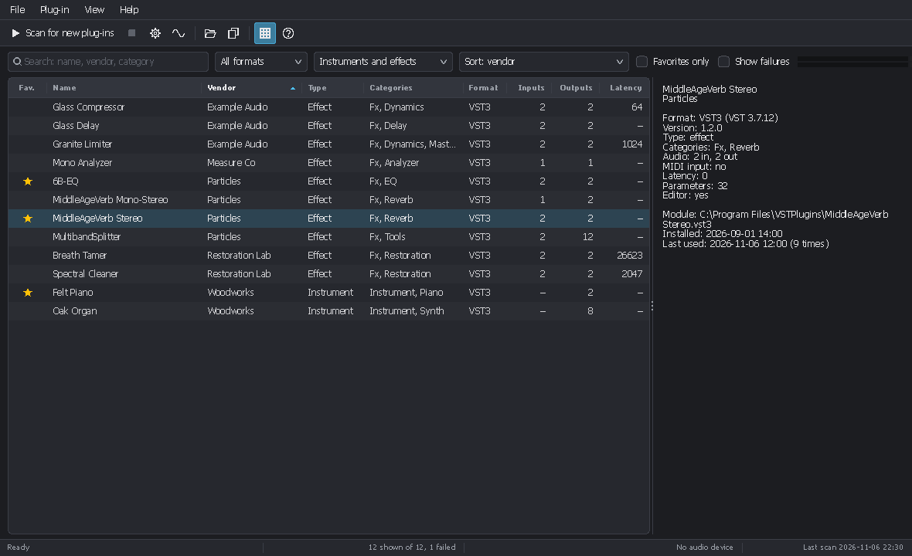
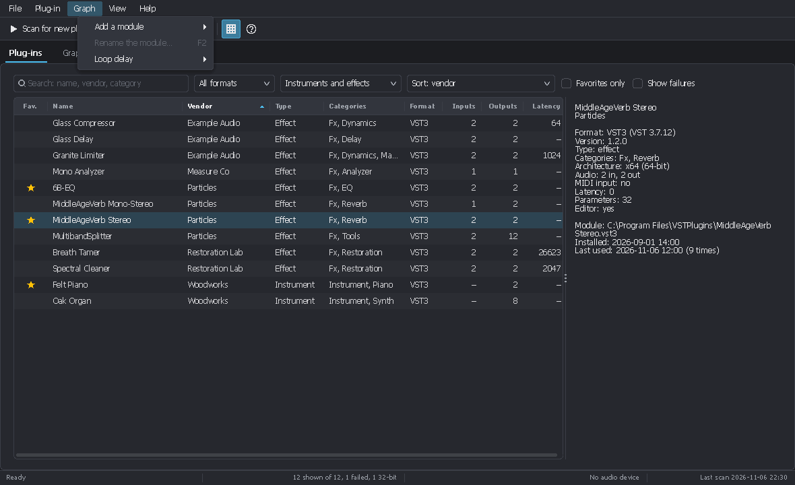
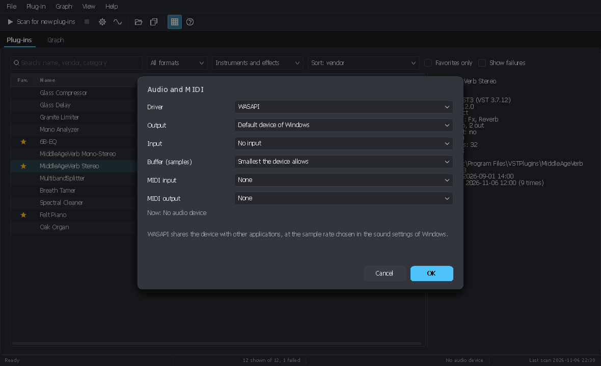
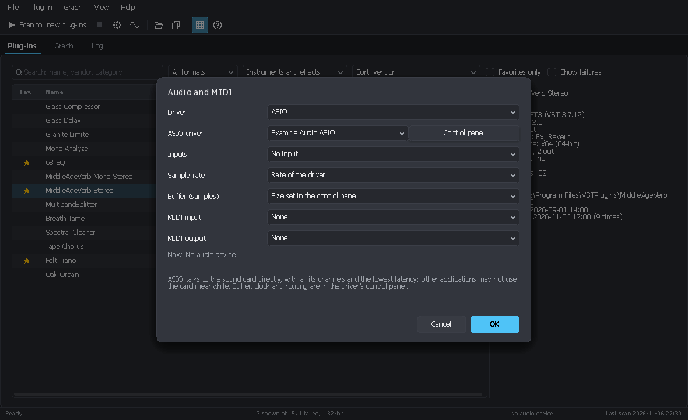
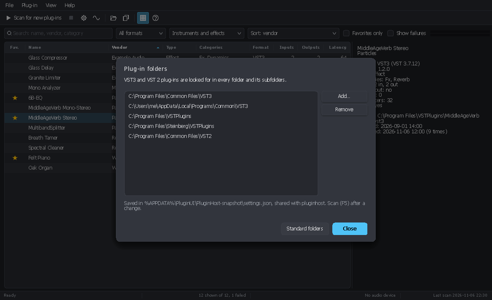
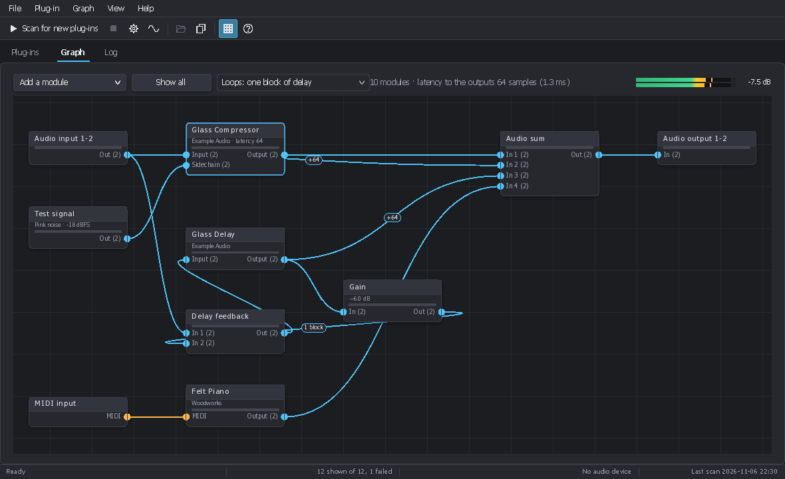
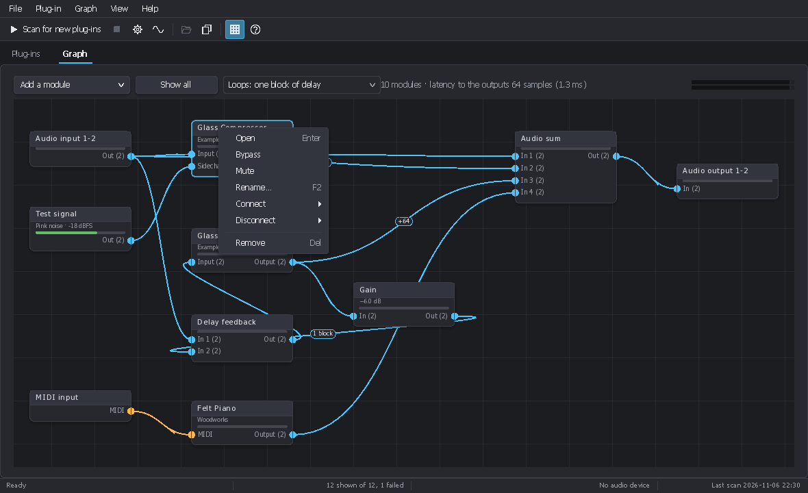
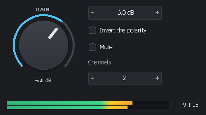
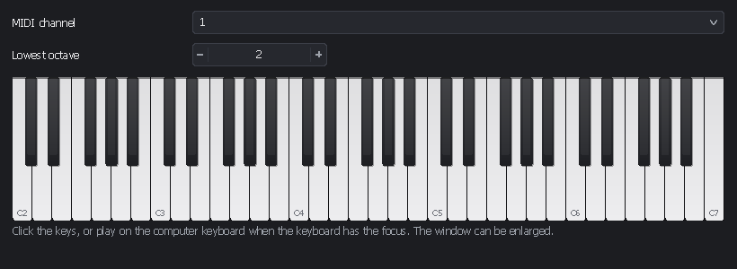
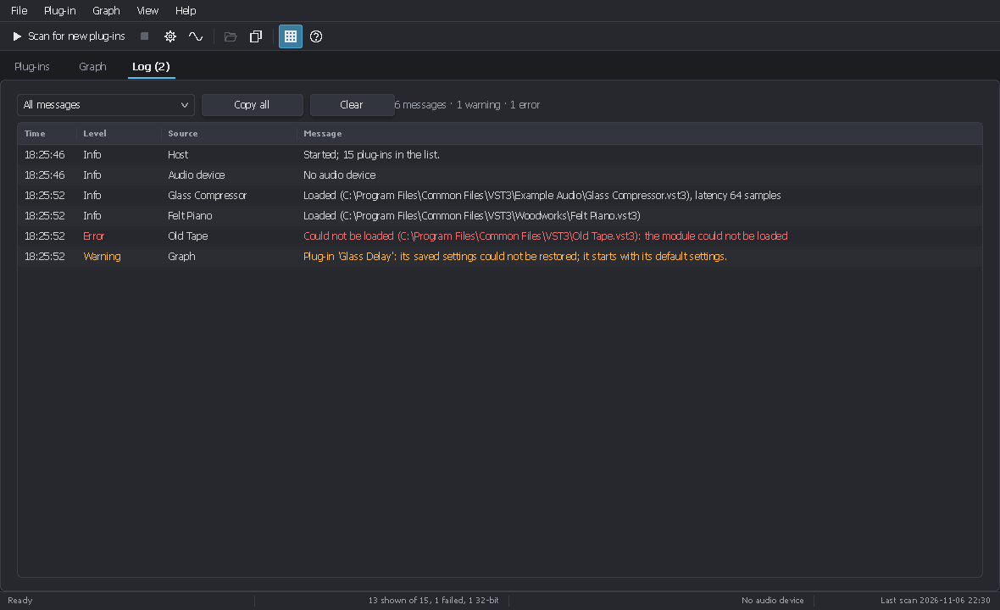

<!-- 2026/11/08 15:20:00 UTC - PluginUI -->

# Plug-in host: PluginUI.Host and pluginhost

*[Version française](PLUGIN_HOST_FR.md)*

`PluginUI.Host` loads VST3 plug-ins and runs them from .NET code. The `pluginhost` command line tool, built on it,
scans and lists the installed plug-ins, processes WAV files through chains of plug-ins, renders MIDI files with
instruments and measures frequency responses: it replaces scripts written with Python and Pedalboard, and it compiles
to one native executable (NativeAOT). **Plug-in Host** is the graphical host, built with PluginUI on the same library.

What exists today and what comes next:

| Part | Status |
|---|---|
| VST3 hosting (files, bundles, NPlug factory in the same process) | done |
| Plug-in folders in a settings file, scanned list kept between runs | done |
| Offline processing, MIDI rendering, response measurement (`pluginhost`) | done |
| VST 2 plug-ins (VST 2.4 and older; shells such as WaveShell; .fxp / .fxb presets) | done (separate package `PluginUI.Host.Vst2`, written from the public description of the interface) |
| Real-time audio (WASAPI output and input), signal sources, on-screen keyboard, MIDI input | done |
| MIDI output, system exclusive, MIDI produced by plug-ins (to a port, another plug-in or a file) | done |
| ASIO (all the channels of the card, its sample rates, its control panel) | done |
| Graphical host: plug-in list with sort orders and columns, editor windows, presets | done |
| Modular graph engine: modules and cables, loops, latency compensation, graph files (`PluginGraph`, `pluginhost graph`) | done |
| Graph view in the graphical host: modules, cables, plug-in windows, graph files | done |

## Contents

- [The command line host](#the-command-line-host)
  - [Building](#building)
  - [Plug-in folders and the plug-in list](#plug-in-folders-and-the-plug-in-list)
  - [Naming a plug-in](#naming-a-plug-in)
  - [Inspecting a plug-in](#inspecting-a-plug-in)
  - [Processing audio files](#processing-audio-files)
  - [Rendering MIDI with an instrument](#rendering-midi-with-an-instrument)
  - [Rendering a modular graph](#rendering-a-modular-graph)
  - [Measuring a response](#measuring-a-response)
  - [Presets](#presets)
  - [From Pedalboard to pluginhost](#from-pedalboard-to-pluginhost)
- [The graphical host](#the-graphical-host)
- [The library](#the-library)
- [Files](#files)
- [How it works](#how-it-works)

## The command line host

### Building

Ready-made executables are attached to each [release](https://github.com/asm8086/PluginUI/releases) from 0.3.0:
`pluginhost-cli-<version>-win-x64.zip` (or `win-arm64`) holds `pluginhost.exe`, `PluginHost-<version>-win-x64.zip`
the graphical host. Both are single native executables, without .NET runtime. To build them:

```
dotnet build tools/PluginHost.Cli                                   # IL, run with: dotnet pluginhost.dll
dotnet publish tools/PluginHost.Cli -c Release -r win-x64 -p:PublishAot=true   # one native pluginhost.exe
```

`pluginhost --help` lists the commands. Exit codes: 0 success, 1 wrong command line, 2 error (file, plug-in).

### Plug-in folders and the plug-in list

The folders to scan are kept in one list in `settings.json`; the first run fills it with the standard folders that
exist (`C:\Program Files\Common Files\VST3`, `%LOCALAPPDATA%\Programs\Common\VST3`, `C:\Program Files\VSTPlugins`,
`C:\Program Files\Steinberg\VSTPlugins`, `C:\Program Files\Common Files\VST2`, the folder registered by Steinberg in
the registry; on Linux `~/.vst3`, `/usr/lib/vst3`, `/usr/local/lib/vst3`, `~/.vst`, `/usr/lib/vst`, `/usr/local/lib/vst`).
Every folder and its subfolders are searched for both formats: `.vst3` modules, and the libraries with a VST 2 entry
point (the libraries the plug-ins use are left out without being loaded, and so are those inside `.vst3` bundles).
Each plug-in of a shell module (Waves' WaveShell) is listed on its own; 32-bit plug-ins are listed as failed, with the
reason. Settings of earlier versions, with separate VST3 and VST2 lists, are merged into the single list.

```
pluginhost folders                          # list the folders
pluginhost folders add "D:\Audio\VST3"      # add one
pluginhost folders remove "D:\Audio\VST3"
pluginhost folders reset                    # back to the standard folders
```

`scan` finds the plug-ins and stores them in `plugins.json`. Each module is opened **in a separate process**, on a
single-threaded apartment thread as in a DAW: a plug-in that crashes, or makes no progress for 30 s (a shell module with
hundreds of plug-ins may take minutes, as long as it advances), is listed as failed with the reason, and the scan goes
on. What plug-ins print while loading does not disturb the scan, and a failure names the last step the plug-in reached
(loading the library, creating the component, initializing…). Later scans only open the
modules that are new or changed (size or date); `--all` opens everything again. Favorites and usage counts survive
rescans.

```
pluginhost scan
[1/3] C:\Program Files\Common Files\VST3\FabFilter\FabFilter Pro-Q 3.vst3
…
41 modules: 3 scanned, 38 unchanged, 0 plug-ins removed, 1 failed.
52 plug-ins available. List: C:\Users\…\AppData\Roaming\PluginUI\PluginHost\plugins.json
  failed: C:\…\Old.vst3: The scanner stopped (code 0xC0000005).
```

`list` shows the list without opening any plug-in:

```
pluginhost list                              # by name
pluginhost list eq --sort vendor             # text search (name, vendor, sub-categories), sorted by vendor
pluginhost list --instruments --sort recent  # instruments, most recently used first
pluginhost list --sort inputs --desc         # most input channels first
pluginhost list --failed                     # also show the modules that could not be opened, with the reason
pluginhost list --json                       # everything, for scripts
pluginhost favorite "Pro-Q 3"                # mark (or --off) a favorite
```

Sort orders: `name`, `vendor` (or `brand`), `category`, `format` (or `type`: VST2 / VST3), `inputs`, `outputs`
(channels), `latency`, `installed` (module date), `recent` (last use), `used` (use count), `favorites`, `folder`,
`status`.

### Naming a plug-in

Wherever a command takes `<plugin>` (`-p`), give:

- a name from the list, whole or partial, case ignored: `"Pro-Q 3"`, `pro-q`;
- `Vendor/Name` when two vendors use the same name: `"FabFilter/Pro-Q"`;
- a path to a `.vst3` file or bundle, optionally followed by `|Class name` when the module holds several plug-ins:
  `"D:\Tests\MyPlugin.vst3"`, `"D:\Tests\Suite.vst3|Suite Compressor"`.

### Inspecting a plug-in

```
pluginhost info "Pro-Q 3"
pluginhost info "Pro-Q 3" --json
```

Vendor, version, category, buses and channels, latency, tail, editor, and every parameter with its id, current value
as the plug-in displays it, default value, steps and flags.

### Processing audio files

```
pluginhost process -i dry.wav -o wet.wav -p "Pro-Q 3" --preset bright.vstpreset -p "Pro-L 2" --set "Gain=+3 dB"
```

- `-p` adds a plug-in to the chain; the options after it apply to that plug-in: `--set "Name=value"` (the text the
  plug-in displays, units optional: `"Gain=-6 dB"`, `"Gain=-6"`, `"Mode=Warm"`), `--set-normalized "Name=0.25"`,
  `--preset file.vstpreset`.
- A mono file through a stereo plug-in feeds both channels. Files with more than two channels are read and written
  (`WAVE_FORMAT_EXTENSIBLE`); each plug-in receives as many channels as its input bus has.
- The latencies reported by the plug-ins are compensated (the output is aligned with the input and keeps its length);
  `--no-latency-compensation` keeps the raw output.
- The tail (reverb, delay) is rendered after the end of the file: as long as the plug-ins report, at most 10 s, or
  `--tail <seconds>`.
- `--block 512` processing block size; `--bits 16|24|32|f32|f64` output format (default 32-bit float; 16 and 24-bit
  are dithered).
- Sample rate: that of the input file.

### Rendering MIDI with an instrument

```
pluginhost render -p "Diva" --preset pad.vstpreset --midi chords.mid -o pad.wav --rate 48000 --tail 4
```

Standard MIDI files of type 0 or 1, with their tempo changes. Notes and polyphonic pressure are sent as VST3 events;
controllers, channel pressure and pitch bend go to the parameters the instrument assigns to them (`IMidiMapping`), as
in a DAW. Effects can follow the instrument: add more `-p`.

### MIDI produced by plug-ins

```
pluginhost render -p "Arpeggiator" --midi chords.mid --midi-out arp.mid
pluginhost render -p "Arpeggiator" -p "Diva" --midi chords.mid -o arp.wav
pluginhost process -i dry.wav -p "Pitch Tracker" --midi-out melody.mid
```

A plug-in with a MIDI output (VST3 event output bus: arpeggiators, chord generators, pitch trackers) passes its notes
and controllers to the next plug-in of the chain; `--midi-out` writes what the last plug-in produces to a MIDI file
(type 0, 960 ticks per quarter note, 120 BPM, times compensated for the latencies). When the last plug-in produces only
MIDI, `-o` can be left out. `process` also accepts `--midi <file.mid>` (a vocoder or a side-chained gate driven by
notes).

### Rendering a modular graph

```
pluginhost graph mastering.pluginui-graph -i mix.wav -o master.wav
pluginhost graph pads.pluginui-graph --midi chords.mid -o pads.wav --tail 4
pluginhost graph drone.pluginui-graph --length 30 -o drone.wav
```

A graph file (`.pluginui-graph`, saved by Plug-in Host, or written by a program with `PluginGraph`, see
[the library](#modular-graphs)) holds modules joined by cables: plug-ins with their state, audio and MIDI inputs and
outputs, files, test signals, sums, gains, muxers. `-i` plays the role of the audio device's input (its channels feed the
audio input modules), `--midi` feeds the MIDI input modules, and the output file has every channel an audio output
module writes to. `--midi-out` collects what reaches the MIDI output modules. Without `-i` or `--midi`, give the
length with `--length`. The latency of the longest path to an output is removed (unless
`--no-latency-compensation`), and the automatic tail is the longest one the plug-ins report — 10 s when the graph has
a loop. A plug-in that cannot be found is reported and stays silent; the rest of the graph plays.

### Measuring a response

```
pluginhost measure -p "Pro-Q 3" --preset tilt.vstpreset -o tilt.csv --ir tilt-ir.wav
pluginhost measure -p "My EQ" -o eq.csv --method sine --points 60 --level -20 --db 6log2
```

- `impulse` (default): an impulse through the plug-in, FFT of the response, with the latency removed from the phase.
  `--ir` also saves the impulse response.
- `sine`: one sine per frequency, the fundamental is measured after the plug-in has settled; slower, but suited to
  nonlinear plug-ins (`--level` in dBFS).
- `--min 20 --max 20000 --points 200`: logarithmic frequencies. `--channel` chooses the input channel that receives
  the signal; every output channel is measured.
- CSV: `frequency_hz,magnitude_db_1,phase_deg_1,…`. `--db 6log2` writes 6·log2 of the ratio instead of 20·log10.

### Presets

```
pluginhost preset show bright.vstpreset                       # class, plug-in, state sizes, metadata
pluginhost preset save "Pro-Q 3" --set "Output Level=-3 dB" -o quieter.vstpreset
```

`.vstpreset` files are those of Steinberg's SDK: they open in any VST3 host. VST 2 plug-ins use `.fxp` (one program)
and `.fxb` (a bank): `preset save` writes an `.fxb` for plug-ins that save their state as a chunk, an `.fxp` of the
current program otherwise; `preset show` and `--preset` read both, as parameter values or chunks.

### From Pedalboard to pluginhost

| Python and Pedalboard | pluginhost |
|---|---|
| `load_plugin("Pro-Q 3.vst3")` | `-p "Pro-Q 3"` (from the list) or `-p "C:\…\Pro-Q 3.vst3"` |
| `plugin.gain_db = -6` | `--set "Gain=-6 dB"` |
| `plugin.raw_state = …` / `load_preset` | `--preset file.vstpreset` |
| `Pedalboard([a, b])(audio, sr)` | `process -i in.wav -o out.wav -p a -p b` |
| `instrument(midi_messages, duration, sr)` | `render -p instrument --midi file.mid -o out.wav` |
| `plugin.parameters` | `info <plugin>` |
| plug-in discovery by hand | `scan`, `list`, kept between runs |

Main differences: plug-ins are scanned once and found by name; a crashing plug-in does not stop the scan; latency is
compensated; responses are measured directly; one executable, no Python installation.

## The graphical host

**Plug-in Host** (`tools/PluginHost.Desktop`, `PluginHost.exe`) is the same host with a window, built with PluginUI. It
shares the plug-in folders, the plug-in list and the graph files with `pluginhost`: a scan made by one is seen by the
other, a graph saved here is rendered there (`pluginhost graph`). It has three tabs: **Plug-ins**, the list of the
installed plug-ins, **Graph**, the modules that play and their cables, and **Log**, the messages of the session
(Ctrl+1, Ctrl+2, Ctrl+3).

The **user manual** of Plug-in Host — a tutorial, every window, the keyboard shortcuts and troubleshooting — is available
as a web page ([English](manual/en/index.html), [français](manual/fr/index.html)) and as PDF files
([English](manual/en/PluginHost-Manual-en.pdf), [français](manual/fr/PluginHost-Manuel-fr.pdf)).

```
dotnet run --project tools/PluginHost.Desktop                                    # IL, with the debugger
dotnet publish tools/PluginHost.Desktop -c Release -r win-x64 -p:PublishAot=true # one native PluginHost.exe
```



- **Plug-in list**: search (name, vendor, categories; Ctrl+F), format (VST3 / VST2), instruments or effects, favorites
  only, failures shown or not. Click a column header to sort (again for the reverse order), or choose an order in the
  **Sort** list: name, vendor, category, format, input or output channels, latency, installation date, recently used,
  most used, favorites first, folder, status. Right click on the header (or **View > Columns**) shows or hides columns:
  favorite, name, vendor, type, categories, format, inputs, outputs, sidechain, MIDI, latency, parameters, editor,
  version, installed, last used, uses, folder, status. Widths, columns, sort and filters are kept between runs.
- **Details** (Ctrl+I): format and SDK, version, categories, buses, MIDI input, latency in samples and milliseconds,
  parameters, editor, module path, dates, use count, and the reason of a failure.
- **Full screen** (F11, View menu; Esc to leave): the window covers the whole screen, without title bar.


- **Plug-in menu** (also the right click on a row, or the menu key): add to the graph (Enter, double-click), favorite
  (Ctrl+D), show in Explorer, copy the path, ignore the module (it is left out of later scans).
- **Scan** (F5: new and changed modules; Shift+F5: everything again; **Stop the scan** in the File menu or the tool bar): the scan runs in separate processes,
  with its progress in the status bar; the list changes only when it is complete.
- **Plug-in folders** (Ctrl+Shift+F): one list of folders, each searched for VST3 and VST 2 plug-ins; standard
  folders.
- **Audio and MIDI** (Ctrl+Shift+A): the driver, **WASAPI**, **ASIO** or none, then
  - with WASAPI: output device, input device, buffer size (the smallest the device allows by default: often under
    3 ms at 48 kHz); the device is shared with the other applications at the rate of the sound settings of Windows;
  - with ASIO: the driver of the sound card and its **Control panel** (buffer, clock, routing; it opens while the
    driver runs), its inputs (none or all), the sample rate (the driver's, or 44.1 to 192 kHz when the card accepts
    it), the buffer (the control panel's by default). Every output channel of the card is available: a multichannel
    plug-in is heard on as many outputs. When the control panel changes the buffer or the rate, the host restarts
    the driver by itself;
  - MIDI input port, MIDI output port.

  The status bar shows the device, its sample rate and its buffer; the meter at the right of the graph's bar shows the
  output level, and beside it the highest peak in dB since it was last clicked.







### The graph



What plays is a **graph of modules** joined by **cables**. A double-click (or Enter) on a plug-in of the list loads it
as a module of the graph: its MIDI input is connected to the MIDI input module, its main output to an audio output
module that has no cable yet; the rest is cabled by hand. A plug-in plays as long as its module is in the graph, its
window open or not.

- **Modules**: the plug-ins (one connector per bus — main, side chain… — with its channel count, plus MIDI in and
  out), **Audio input** and **Audio output** (channels of the device: first channel and count), **Test signal** (sine,
  square, sawtooth, triangle, white or pink noise, sweep, impulses), **Audio file** (WAV in a loop, resampled to the
  device rate), **MIDI input** (the MIDI input port, all channels or one), **Keyboard** (an on-screen keyboard, in its
  window), **MIDI output** (to the MIDI output port), **Gain** (dB, polarity, mute), **Audio sum**, **MIDI merge**,
  **Muxer** (mono cables joined into one of several channels: L and R into a stereo cable) and **Demuxer** (the
  reverse). Add them with **Add a module** (bar, Graph menu, or right click on an empty place: the module goes there).
- **Cables**: drag from a connector to another one (from an output or from an input); only the compatible connectors
  light up (audio to audio, MIDI to MIDI). An output feeds as many cables as wanted; **an input takes one cable**: a
  new one replaces it, and signals are added only by an **Audio sum** or a **MIDI merge** module. Drag the end of a
  cable away from its input to move it or to remove it; click a cable then Delete removes it too. A mono signal
  entering a stereo input feeds both channels; two channels entering a mono input are averaged.
- **Loops** are allowed: the cable that closes a loop is drawn dashed and delivers its signal **one block late** — a
  plug-in processes whole blocks. **Loops** in the bar (or Graph > Loop delay) runs the modules of loops in shorter
  sub-blocks of 16 to 128 samples: the delay becomes that sub-block, at the cost of more calls to their plug-ins.
  **Break the loop here** (menu of a cable) chooses which cable is late.
- **Latency**: a sum delays its inputs so that paths through plug-ins of different latency arrive aligned (the delay
  added shows on the cable, `+64`); it can be turned off in its properties. The bar shows the latency up to the
  outputs.
- **Opening a module** (double-click, Enter): a plug-in opens its window, the other modules open a **window of their
  settings**, which apply at once (channels, signal, file, number of inputs, gains of a sum…) and stays open while the
  graph plays — several at a time. The **Gain** window has a large knob and a meter; the **Keyboard** window a keyboard
  that can be enlarged, played with the mouse or the computer keyboard, and an octave choice. **Rename** (F2) gives a
  module another name.
- **Menu of a module** (right click, Shift+F10): open, bypass and mute (plug-ins), rename, **Connect**
  (every compatible input, for the keyboard and screen readers), **Disconnect**, remove (Delete; the settings of a
  plug-in are lost, so the host asks first).
- **View**: drag an empty place to move the view (the middle button or Alt+drag too); scroll bars when the graph is
  larger than the view; the wheel scrolls (Shift+wheel sideways), Ctrl+wheel zooms around the mouse, **Show all**
  (Home) fits the graph, and the zoom buttons of the bar (**−**, the zoom in percent — click it for the actual size,
  Ctrl+0 —, **+**) zoom from 10 % to 250 %. Modules move on a grid that holds their first connector (Shift = free), so the cables between
  aligned modules are straight; Shift+drag on an empty place selects several modules, Ctrl+click adds one.
  Ctrl+Left / Ctrl+Right select the previous or next module, the arrows move the selection.
- **Graph files** (File menu): **New graph** (Ctrl+N: an audio input, a MIDI input and an audio output), **Open a
  graph** (Ctrl+Shift+O), **Save the graph** (Ctrl+S), **Save the graph as** (Ctrl+Shift+S). A `.pluginui-graph` file
  keeps the modules, their places, the cables and the state of each plug-in. A plug-in that cannot be found when a
  graph is opened stays as a **missing** module: silent, with its cables and its state, saved back unchanged; the reason
  is in its tooltip, in its window (double-click) and in the log. A plug-in that loads but refuses its saved state
  stays loaded with its default settings, and the log says so. The graph as it was when the host closed comes back at
  the next start.







### The log



The **Log** tab lists the messages of the session, with their time, level and source: the start, the audio device,
each plug-in loaded (with its file and its latency) or refused (with the reason), the graph files opened and saved,
what could not be restored, the plug-ins a scan could not load. The messages of the status bar go there too, so none
is lost when it fades. The list shows everything, the warnings and errors, or the errors only; **Copy all** puts the
messages shown in the clipboard (time, level, source, message, separated by tabs), to paste them in a mail or a bug
report; the right click copies the selected rows. The title of the tab counts the warnings and errors.

### Plug-in windows

The window of a plug-in shows the plug-in's editor, sized as the plug-in asks (and resizable when the plug-in allows
it), or the **generic parameter table** when it has none (**Parameters** button otherwise). Values can be typed in
the table as the plug-in displays them (`-6 dB`, `Warm`) or as normalized values. **Load preset** / **Save preset**
read and write `.vstpreset` files (`.fxp` / `.fxb` for VST 2 plug-ins). The bar at the bottom holds **Bypass** (the
main input goes straight to the main output), **Mute**, the meter of the plug-in's output and, for instruments, an
**on-screen keyboard** (mouse, or the computer keyboard when it has the focus) whose notes go to this plug-in; the
notes of the MIDI input port light up its keys. Closing the window closes the editor only: the plug-in keeps playing
in the graph. Without an audio device, the graph runs on a clock at 48 kHz with silent output, so that editors and
parameters still behave as in a DAW.

**Full screen** (the button of the top bar, or F11) shows the plug-in window on the whole screen, for a stage or a
second monitor: a resizable editor fills it, a fixed-size one is centred. Esc or the button leaves it; when the
plug-in's own editor has the keyboard, click the top bar first.

`PluginHost.exe` also serves as the scanner's child process (`PluginHost.exe scan-module …`), like `pluginhost`.
`PluginHost.exe --config <folder>` uses another settings folder; the interface settings are in `gui.json` next to
`settings.json`, the graph of the last session in `session.pluginui-graph`.

## The library

```csharp
using PluginUI.Host;
using PluginUI.Host.Audio;
using PluginUI.Host.Catalog;

var catalog = PluginCatalog.Load(HostPaths.CatalogFile);   // the list made by "pluginhost scan"
using var loader = new PluginLoader(catalog);
var eq = loader.Load("Pro-Q 3");                            // or a path
eq.TryParseParameter(eq.FindParameter("Output Level")!.Id, "-3 dB", out double value);
eq.SetParameter(eq.FindParameter("Output Level")!.Id, value);

var input = WavFile.Read("dry.wav");
var output = OfflineRenderer.Render([eq], input, input.SampleRate);
WavFile.Write("wet.wav", output, WavSampleFormat.Int24);
catalog.Save(HostPaths.CatalogFile);                        // keeps "last used"
```

Live, on an audio device (`PluginUI.Host.Windows`): a `PluginRack` holds the plug-ins, each with its source, and a
driver plays it.

```csharp
using PluginUI.Host.Windows;

var rack = new PluginRack();
var slot = rack.Add(eq, new TestSignalGenerator { Signal = TestSignal.PinkNoise, LevelDb = -18 });
using var device = new WasapiDriver(outputId: null);       // default device of Windows; Wasapi.GetEndpoints lists them
device.Start(rack);
slot.SendMidi(MidiEvent.NoteOn(0, 0, 60, 100));            // any thread
```

`AsioDriver` plays it through an ASIO driver (`Asio.GetDrivers()` lists them):

```csharp
using var card = new AsioDriver("My Card ASIO", bufferFrames: 128, sampleRate: 96000, inputChannels: -1);
card.ResetRequested += _ => ui.Post(() => card.Start(rack));   // buffer or rate changed in its control panel
card.Start(rack);                                              // on the UI thread (STA, message loop)
card.ShowControlPanel();
```

`inputChannels`: 0 none (default), -1 all, n the first n; `outputChannels` likewise (-1, all, by default). After
`Start`: `InputChannelNames`, `OutputChannelNames`, `BufferSizes`, `SupportedSampleRates`, `SampleFormat`,
`InputLatencySamples` / `OutputLatencySamples`. Samples in 16, 24 and 32-bit integers (also right-justified in 32
bits) and 32 or 64-bit floats, little or big-endian, are converted from and to 32-bit float. One ASIO driver at a
time per process, 64-bit only. ASIO is a trademark of Steinberg Media Technologies GmbH; the binding is written from
NAudio's (MIT), without the ASIO SDK.

`NullAudioDriver` runs the rack on a clock without a device. Sources: `SilenceSource`, `DeviceInputSource`,
`TestSignalGenerator`, `FileSource`; `RackSlot.Bypass`, `Mute`, `GainDb`, `Meter`; `MidiInput` opens a MIDI input
port (short messages with their time, system exclusive on request), `MidiOutput` an output port (`Send`, `SendSysex`,
`AllNotesOff`).

### Modular graphs

`PluginGraph` plays modules joined by cables, live (it is an `IAudioRenderer`, like `PluginRack`) or offline
(`OfflineRenderer.Render(graph, …)`):

```csharp
using PluginUI.Host.Graph;

var graph = new PluginGraph();
var input = graph.Add(new AudioInputNode { FirstChannel = 0, Channels = 2 });
var comp = graph.Add(new PluginNode(loader.Load("Pro-C 2"), PluginReference.From(description)));
var sum = graph.Add(new AudioSumNode());                        // dry + wet: parallel compression
var output = graph.Add(new AudioOutputNode());
graph.Connect(input.Outputs[0], comp.Inputs[0]);
graph.Connect(comp.Outputs[0], sum.Inputs[0]);
graph.Connect(input.Outputs[0], sum.Inputs[1]);                 // the dry path waits for the compressor's latency
graph.Connect(sum.Outputs[0], output.Inputs[0]);
device.Start(graph);
graph.Save("parallel.pluginui-graph");
```

- **Modules**: `PluginNode` (one port per bus of the plug-in — main, side chain… — and its MIDI input and output),
  `AudioInputNode` / `AudioOutputNode` (channels of the device), `TestSignalNode`, `AudioFileNode` (WAV in a loop),
  `MidiInputNode` (fed by `graph.PostMidiInput`), `KeyboardNode`, `MidiOutputNode` (to `graph.MidiOutput`), `GainNode`
  (gain, polarity, mute), `AudioSumNode` (inputs with their gains), `MidiMergeNode`, `MuxNode` / `DemuxNode` (mono
  cables joined into one of several channels — two into a stereo one — and the reverse). Your own: derive from `GraphNode`
  (ports with `SetPorts`, processing in `Process` with a `NodeContext`) and register the type with
  `PluginGraph.RegisterNodeType` so files can create it.
- **Cables**: an output feeds any number of inputs; an input takes one cable (`Connect` replaces it): signals are only
  added by a sum module. Audio goes to audio, MIDI to MIDI. Widths are converted: a mono signal feeds every channel,
  several channels entering a mono input are averaged, otherwise the first channels are copied.
- **Loops** are allowed. The most recent cable of a loop is its feedback cable (`IsFeedback`): it delivers one block
  late, since a plug-in processes whole blocks. `LoopBlockSize` runs the modules of loops in shorter sub-blocks (the
  delay becomes that sub-block); `BreakLoopAt` chooses the cable.
- **Latency**: `PathLatencySamples` gives each module's latency from the sources; a sum (`CompensateLatency`, on by
  default) delays its inputs so they arrive aligned (`DelaySamples` on the cable). A plug-in changing its latency is
  followed.
- **Files**: `ToJson` / `Save` and `LoadJson` / `Load`, with a function that loads plug-ins (`loader.Load` takes the
  saved `PluginReference`). A plug-in that cannot be loaded becomes a `MissingPluginNode`, which keeps its cables and
  state and is saved back unchanged; `Load` returns what could not be restored.
- **Threads**: edit the graph on the UI thread; each edit swaps in a new execution plan, the audio thread never waits.
  `NodeFailed` reports a module that threw (it falls silent until the graph is prepared again).

The MIDI a plug-in produces is in `plugin.OutputMidi` after each `Process` (`EventOutputCount` > 0 when it has an event
output). In a rack, `RackSlot.MidiOut` takes an `IMidiSink`, called on the audio thread: a `MidiOutput` (it queues the
messages, a thread of the port sends them), another `RackSlot`, or your own. `RenderOptions.MidiOutput` receives it in
offline renders, and `MidiFile.Write` saves events to a file.

```csharp
using var port = MidiOutput.Open(MidiOutput.Ports[0]);
arpSlot.MidiOut = port;                                    // or synthSlot
```

Real-time use, without the renderer: `Prepare(sampleRate, maxBlock, realtime: true)`, then for each block fill
`GetInput(channel)`, call `Process(frames)` and read `GetOutput(channel)`. `SetParameter` and `AddMidiEvent` can be
called from any thread for the next block; `Idle()`, on the user interface thread, delivers the values the plug-in
changes itself (`ParameterChanged`) and the editor's edits, and gives VST 2 editors their idle time. `GetState` /
`SetState` read and write preset images (`PresetExtension`: `.vstpreset`, `.fxp` or `.fxb`). For an editor window:
`plugin.CreateEditor()?.Attach(hwnd, "HWND")` (a `PluginEditor`, `Vst3Editor` or `Vst2Editor`).

VST 2 plug-ins come with the `PluginUI.Host.Vst2` package:

```csharp
using PluginUI.Host.Vst2;

Vst2Hosting.Register();                                     // the scanner and PluginLoader handle VST 2 modules
using var synth = Vst2Hosting.Load(@"C:\Program Files\VSTPlugins\MySynth.dll");
using var waves = Vst2Hosting.Load(@"C:\Program Files\VSTPlugins\WaveShell1-VST 14.0_x64.dll", "C1 comp Stereo");
var bank = FxPreset.Read(File.ReadAllBytes("pads.fxb"));
synth.SetPreset(bank);
```

`Vst2Plugin` adds what VST 2 has of its own: `UniqueId`, `Category`, `VstVersion`, programs (`ProgramCount`,
`CurrentProgram`, `GetProgramName`), `UsesChunks`, `CanDo`. Processing is in 32-bit float; plug-ins of VST 1 that only
add to their outputs are handled. `Vst2Module.FromEntryPoint` hosts a VST 2 plug-in linked into the application. VST 2
editors choose their size: they ask for it, the host does not resize them. VST is a trademark of Steinberg Media
Technologies GmbH; no part of the VST SDK is used (the interface is written from its public description).

An NPlug plug-in can be hosted in its own process, without a `.vst3` file, for tests or a standalone application:

```csharp
using var module = Vst3Module.FromFactory(MyPlugin.GetFactory().Export());
using var plugin = module.CreatePlugin();
```

(the project that does this sets `<NPlugFactoryExport>false</NPlugFactoryExport>`).

Scanning from your own application: `PluginScanner.OutOfProcess(exe, args)` runs a helper process (for example
`pluginhost scan-module`) per module; `PluginScanner.InProcess()` opens the modules in the calling process.

## Files

| File | Contents |
|---|---|
| `%APPDATA%\PluginUI\PluginHost\settings.json` (`~/.config/PluginUI/PluginHost` on Linux) | plug-in folders, ignored modules, scan timeout |
| `…\plugins.json` | the plug-in list: identity, buses, channels, latency, parameter count, editor, module size and date, status, favorite, last use, use count |

`--config <folder>` makes `pluginhost` use another folder (one per project, tests). Both files are plain indented
JSON: they can be edited by hand, and are rewritten atomically.

## How it works

The host speaks VST3 directly: the plug-in interfaces are called through their virtual tables
(`delegate* unmanaged[MemberFunction]`), and the host interfaces (`IHostApplication`, `IComponentHandler`,
`IPlugFrame`, `IBStream`, `IParameterChanges`, `IEventList`, `IMessage`, `IAttributeList`) are native blocks pointing to
static `[UnmanagedCallersOnly]` functions. No reflection and no generated COM: NativeAOT compatible, and nothing is
allocated on the audio thread. The structure layouts and interface identifiers follow the VST 3 SDK (MIT license
since version 3.8). Tests (`tests/PluginUI.Host.Tests`) load the DemoSynth sample and a test plug-in with latency in
the same process.

An application that loads plug-ins should be built without the CET shadow stack, which .NET turns on by default since
version 9: add `<CETCompat>false</CETCompat>` to its project. Some plug-ins (copy protection, `longjmp`, coroutines)
manipulate the stack in ways CET forbids, and Windows then ends the process with code 0xC0000409 in `ntdll.dll`; DAWs
do not enable CET either. `pluginhost` is built this way.
