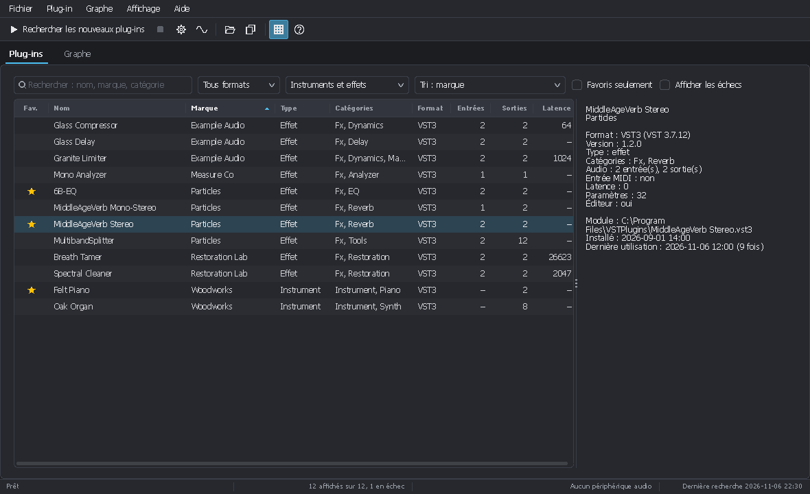
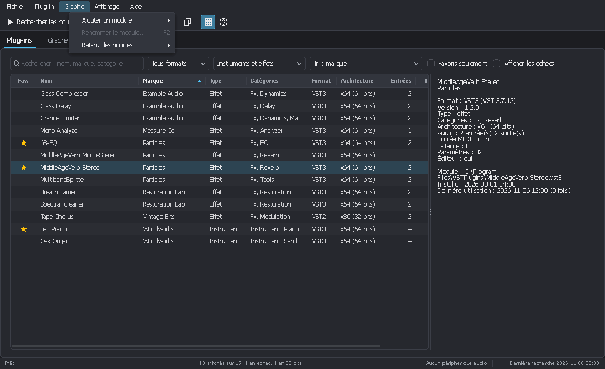
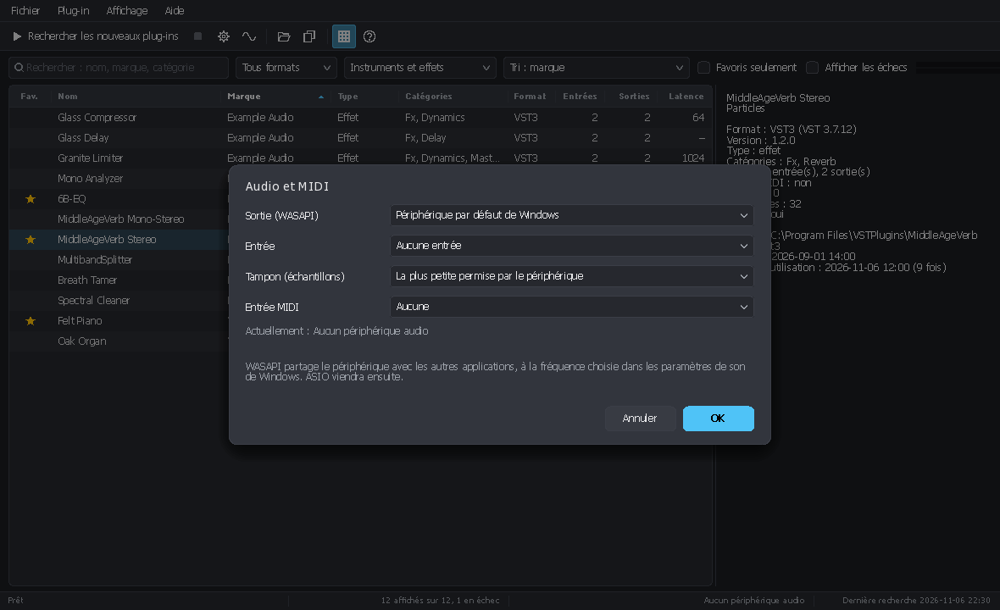
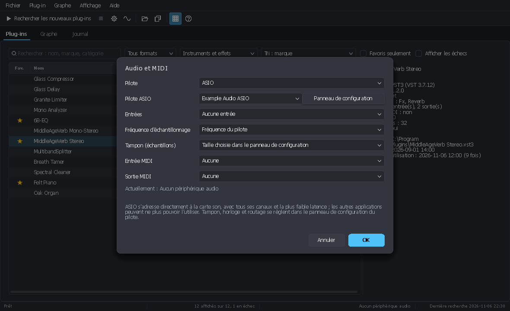
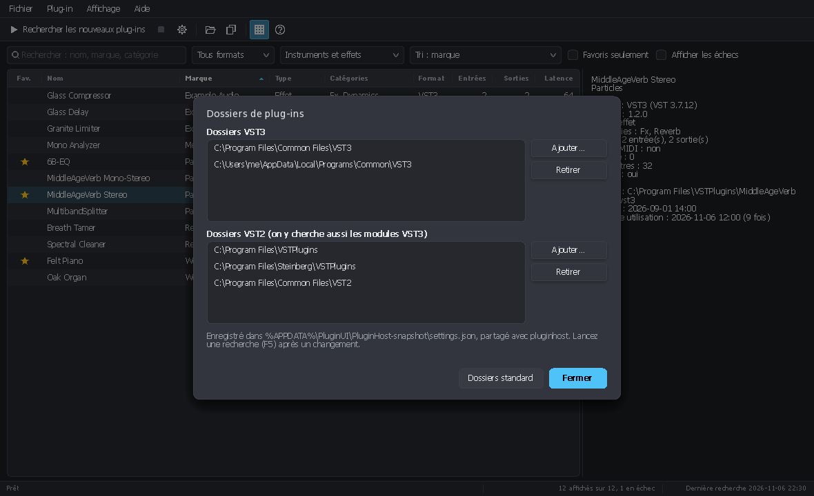
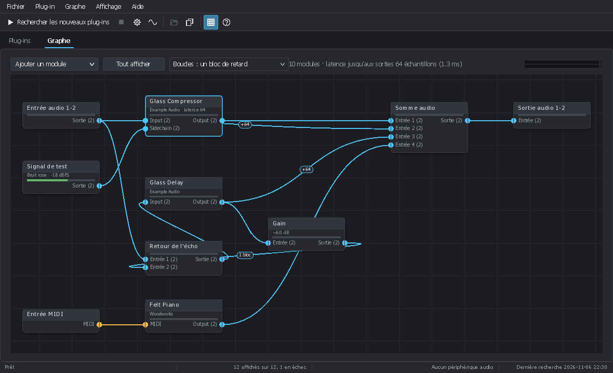
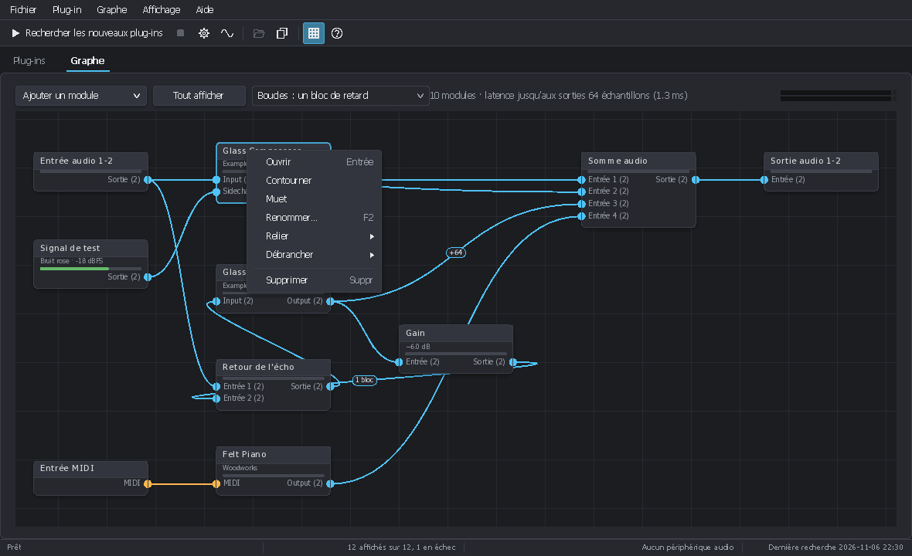
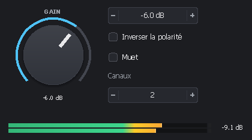
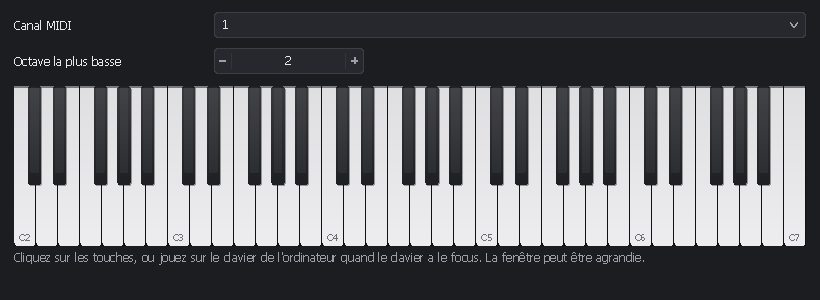

<!-- 2026/11/08 13:07:00 UTC - PluginUI -->

# Hôte de plug-ins : PluginUI.Host et pluginhost

*[English version](PLUGIN_HOST.md)*

`PluginUI.Host` charge des plug-ins VST3 et les fait fonctionner depuis du code .NET. L'outil en ligne de commande
`pluginhost`, construit dessus, recherche et liste les plug-ins installés, traite des fichiers WAV par des chaînes de
plug-ins, rend des fichiers MIDI avec des instruments et mesure des réponses en fréquence : il remplace les scripts
écrits avec Python et Pedalboard, et se compile en un seul exécutable natif (NativeAOT). **Plug-in Host** est l'hôte graphique, construit avec PluginUI sur la
même bibliothèque.

Ce qui existe et ce qui vient ensuite :

| Partie | État |
|---|---|
| Hébergement VST3 (fichiers, bundles, fabrique NPlug dans le même processus) | fait |
| Dossiers de plug-ins dans un fichier de réglages, liste conservée entre les lancements | fait |
| Traitement hors temps réel, rendu MIDI, mesure de réponse (`pluginhost`) | fait |
| Plug-ins VST 2 (VST 2.4 et antérieurs ; shells comme WaveShell ; presets .fxp / .fxb) | fait (paquet séparé `PluginUI.Host.Vst2`, écrit d'après la description publique de l'interface) |
| Audio temps réel (sortie et entrée WASAPI), sources de signal, clavier à l'écran, entrée MIDI | fait |
| Sortie MIDI, messages exclusifs, MIDI émis par les plug-ins (vers un port, un autre plug-in ou un fichier) | fait |
| ASIO (tous les canaux de la carte, ses fréquences, son panneau de configuration) | fait |
| Hôte graphique : liste de plug-ins avec ordres de tri et colonnes, fenêtres d'éditeur, presets | fait |
| Moteur de graphe modulaire : modules et câbles, boucles, compensation de latence, fichiers de graphe (`PluginGraph`, `pluginhost graph`) | fait |
| Vue du graphe dans l'hôte graphique : modules, câbles, fenêtres des plug-ins, fichiers de graphe | fait |

## Sommaire

- [L'hôte en ligne de commande](#lhôte-en-ligne-de-commande)
  - [Compilation](#compilation)
  - [Dossiers de plug-ins et liste des plug-ins](#dossiers-de-plug-ins-et-liste-des-plug-ins)
  - [Désigner un plug-in](#désigner-un-plug-in)
  - [Examiner un plug-in](#examiner-un-plug-in)
  - [Traiter des fichiers audio](#traiter-des-fichiers-audio)
  - [Rendre du MIDI avec un instrument](#rendre-du-midi-avec-un-instrument)
  - [Rendre un graphe modulaire](#rendre-un-graphe-modulaire)
  - [Mesurer une réponse](#mesurer-une-réponse)
  - [Presets](#presets)
  - [De Pedalboard à pluginhost](#de-pedalboard-à-pluginhost)
- [L'hôte graphique](#lhôte-graphique)
- [La bibliothèque](#la-bibliothèque)
- [Fichiers](#fichiers)
- [Fonctionnement](#fonctionnement)

## L'hôte en ligne de commande

### Compilation

Des exécutables prêts à l'emploi sont joints à chaque [release](https://github.com/asm8086/PluginUI/releases) à partir
de la 0.3.0 : `pluginhost-cli-<version>-win-x64.zip` (ou `win-arm64`) contient `pluginhost.exe`,
`PluginHost-<version>-win-x64.zip` l'hôte graphique. Ce sont des exécutables natifs uniques, sans runtime .NET. Pour
les compiler :

```
dotnet build tools/PluginHost.Cli                                   # IL, lancer avec : dotnet pluginhost.dll
dotnet publish tools/PluginHost.Cli -c Release -r win-x64 -p:PublishAot=true   # un seul pluginhost.exe natif
```

`pluginhost --help` liste les commandes. Codes de sortie : 0 succès, 1 ligne de commande incorrecte, 2 erreur
(fichier, plug-in).

### Dossiers de plug-ins et liste des plug-ins

Les dossiers à parcourir sont conservés dans une seule liste de `settings.json` ; le premier lancement y place les
dossiers standard présents (`C:\Program Files\Common Files\VST3`, `%LOCALAPPDATA%\Programs\Common\VST3`,
`C:\Program Files\VSTPlugins`, `C:\Program Files\Steinberg\VSTPlugins`, `C:\Program Files\Common Files\VST2`, le
dossier inscrit par Steinberg dans le registre ; sous Linux `~/.vst3`, `/usr/lib/vst3`, `/usr/local/lib/vst3`, `~/.vst`,
`/usr/lib/vst`, `/usr/local/lib/vst`). Chaque dossier et ses sous-dossiers sont parcourus pour les deux formats : les
modules `.vst3`, et les bibliothèques dotées d'un point d'entrée VST 2 (celles qu'utilisent les plug-ins sont écartées
sans être chargées, de même que celles des paquets `.vst3`). Chaque plug-in d'un module shell (le WaveShell de Waves)
est listé séparément ; les plug-ins 32 bits apparaissent en échec, avec la raison. Les réglages des versions
précédentes, avec des listes VST3 et VST2 séparées, sont fusionnés en une seule liste.

```
pluginhost folders                          # liste les dossiers
pluginhost folders add "D:\Audio\VST3"      # en ajoute un
pluginhost folders remove "D:\Audio\VST3"
pluginhost folders reset                    # retour aux dossiers standard
```

`scan` trouve les plug-ins et les enregistre dans `plugins.json`. Chaque module est ouvert **dans un processus
séparé**, sur un thread à appartement unique (STA) comme dans une STAN : un plug-in qui plante, ou qui ne progresse
plus pendant 30 s (un module « shell » de centaines de plug-ins peut prendre plusieurs minutes, tant qu'il avance), est
noté en échec avec la raison, et la recherche continue. Ce que les plug-ins affichent pendant leur chargement ne
perturbe pas la recherche, et un échec indique la dernière étape atteinte par le plug-in (chargement de la
bibliothèque, création du composant, initialisation…). Les
recherches suivantes n'ouvrent que les modules nouveaux ou modifiés (taille ou date) ; `--all` rouvre tout. Les
favoris et les compteurs d'utilisation survivent aux nouvelles recherches.

```
pluginhost scan
[1/3] C:\Program Files\Common Files\VST3\FabFilter\FabFilter Pro-Q 3.vst3
…
41 modules: 3 scanned, 38 unchanged, 0 plug-ins removed, 1 failed.
52 plug-ins available. List: C:\Users\…\AppData\Roaming\PluginUI\PluginHost\plugins.json
  failed: C:\…\Old.vst3: The scanner stopped (code 0xC0000005).
```

`list` affiche la liste sans ouvrir aucun plug-in :

```
pluginhost list                              # par nom
pluginhost list eq --sort vendor             # recherche de texte (nom, marque, sous-catégories), tri par marque
pluginhost list --instruments --sort recent  # instruments, les plus récemment utilisés d'abord
pluginhost list --sort inputs --desc         # le plus de canaux d'entrée d'abord
pluginhost list --failed                     # montre aussi les modules qui n'ont pas pu être ouverts
pluginhost list --json                       # tout, pour les scripts
pluginhost favorite "Pro-Q 3"                # marque (ou --off) un favori
```

Ordres de tri : `name` (nom), `vendor` ou `brand` (marque), `category`, `format` ou `type` (VST2 / VST3), `inputs`,
`outputs` (canaux), `latency`, `installed` (date du module), `recent` (dernière utilisation), `used` (nombre
d'utilisations), `favorites`, `folder` (dossier), `status` (état).

### Désigner un plug-in

Partout où une commande attend `<plugin>` (`-p`), indiquez :

- un nom de la liste, entier ou partiel, sans tenir compte de la casse : `"Pro-Q 3"`, `pro-q` ;
- `Marque/Nom` quand deux marques utilisent le même nom : `"FabFilter/Pro-Q"` ;
- un chemin vers un fichier ou un bundle `.vst3`, éventuellement suivi de `|Nom de classe` quand le module contient
  plusieurs plug-ins : `"D:\Tests\MonPlugin.vst3"`, `"D:\Tests\Suite.vst3|Suite Compressor"`.

### Examiner un plug-in

```
pluginhost info "Pro-Q 3"
pluginhost info "Pro-Q 3" --json
```

Marque, version, catégorie, bus et canaux, latence, traîne, éditeur, et chaque paramètre avec son identifiant, sa
valeur actuelle telle que le plug-in l'affiche, sa valeur par défaut, ses pas et ses indicateurs.

### Traiter des fichiers audio

```
pluginhost process -i sec.wav -o traite.wav -p "Pro-Q 3" --preset brillant.vstpreset -p "Pro-L 2" --set "Gain=+3 dB"
```

- `-p` ajoute un plug-in à la chaîne ; les options qui le suivent s'appliquent à ce plug-in : `--set "Nom=valeur"` (le
  texte que le plug-in affiche, unités facultatives : `"Gain=-6 dB"`, `"Gain=-6"`, `"Mode=Warm"`),
  `--set-normalized "Nom=0.25"`, `--preset fichier.vstpreset`.
- Un fichier mono passant par un plug-in stéréo alimente les deux canaux. Les fichiers de plus de deux canaux sont lus
  et écrits (`WAVE_FORMAT_EXTENSIBLE`) ; chaque plug-in reçoit autant de canaux que son bus d'entrée en a.
- Les latences annoncées par les plug-ins sont compensées (la sortie est alignée sur l'entrée et garde sa longueur) ;
  `--no-latency-compensation` garde la sortie brute.
- La traîne (réverbération, écho) est rendue après la fin du fichier : autant que les plug-ins l'annoncent, 10 s au
  plus, ou `--tail <secondes>`.
- `--block 512` taille des blocs de traitement ; `--bits 16|24|32|f32|f64` format de sortie (flottant 32 bits par
  défaut ; 16 et 24 bits avec dither).
- Fréquence d'échantillonnage : celle du fichier d'entrée.

### Rendre du MIDI avec un instrument

```
pluginhost render -p "Diva" --preset nappe.vstpreset --midi accords.mid -o nappe.wav --rate 48000 --tail 4
```

Fichiers MIDI standard de type 0 ou 1, avec leurs changements de tempo. Les notes et la pression polyphonique sont
envoyées comme événements VST3 ; les contrôleurs, la pression de canal et le pitch bend vont aux paramètres que
l'instrument leur attribue (`IMidiMapping`), comme dans une STAN. Des effets peuvent suivre l'instrument : ajoutez
d'autres `-p`.

### MIDI émis par les plug-ins

```
pluginhost render -p "Arpeggiator" --midi accords.mid --midi-out arpege.mid
pluginhost render -p "Arpeggiator" -p "Diva" --midi accords.mid -o arpege.wav
pluginhost process -i sec.wav -p "Pitch Tracker" --midi-out melodie.mid
```

Un plug-in doté d'une sortie MIDI (bus d'événements VST3 en sortie : arpégiateurs, générateurs d'accords, détecteurs de
hauteur) transmet ses notes et contrôleurs au plug-in suivant de la chaîne ; `--midi-out` écrit ce que produit le
dernier plug-in dans un fichier MIDI (type 0, 960 ticks par noire, 120 BPM, instants compensés des latences). Quand le
dernier plug-in ne produit que du MIDI, `-o` peut être omis. `process` accepte aussi `--midi <fichier.mid>` (un
vocodeur ou une porte en side-chain pilotés par des notes).

### Rendre un graphe modulaire

```
pluginhost graph mastering.pluginui-graph -i mix.wav -o master.wav
pluginhost graph pads.pluginui-graph --midi accords.mid -o pads.wav --tail 4
pluginhost graph bourdon.pluginui-graph --length 30 -o bourdon.wav
```

Un fichier de graphe (`.pluginui-graph`, enregistré par Plug-in Host, ou écrit par un programme avec `PluginGraph`,
voir [la bibliothèque](#graphes-modulaires)) contient des modules reliés par des câbles : plug-ins avec leur état,
entrées et sorties audio et MIDI, fichiers, signaux de test, sommes, gains, muxers. `-i` joue le rôle de l'entrée du
périphérique audio (ses canaux alimentent les modules d'entrée audio), `--midi` alimente les modules d'entrée MIDI, et
le fichier de sortie a tous les canaux sur lesquels écrit un module de sortie audio. `--midi-out` recueille ce qui
arrive aux modules de sortie MIDI. Sans `-i` ni `--midi`, donnez la durée avec `--length`. La latence du plus long
chemin vers une sortie est retirée (sauf avec `--no-latency-compensation`), et la queue automatique est la plus longue
qu'annoncent les plug-ins — 10 s quand le graphe a une boucle. Un plug-in introuvable est signalé et reste muet ; le
reste du graphe joue.

### Mesurer une réponse

```
pluginhost measure -p "Pro-Q 3" --preset pente.vstpreset -o pente.csv --ir pente-ir.wav
pluginhost measure -p "Mon EQ" -o eq.csv --method sine --points 60 --level -20 --db 6log2
```

- `impulse` (par défaut) : une impulsion traverse le plug-in, FFT de la réponse, latence retirée de la phase. `--ir`
  enregistre aussi la réponse impulsionnelle.
- `sine` : une sinusoïde par fréquence, la fondamentale est mesurée une fois le plug-in stabilisé ; plus lent, mais
  adapté aux plug-ins non linéaires (`--level` en dBFS).
- `--min 20 --max 20000 --points 200` : fréquences logarithmiques. `--channel` choisit le canal d'entrée qui reçoit le
  signal ; tous les canaux de sortie sont mesurés.
- CSV : `frequency_hz,magnitude_db_1,phase_deg_1,…`. `--db 6log2` écrit 6·log2 du rapport au lieu de 20·log10.

### Presets

```
pluginhost preset show brillant.vstpreset                     # classe, plug-in, tailles des états, métadonnées
pluginhost preset save "Pro-Q 3" --set "Output Level=-3 dB" -o moins-fort.vstpreset
```

Les fichiers `.vstpreset` sont ceux du SDK de Steinberg : ils s'ouvrent dans tout hôte VST3. Les plug-ins VST 2
utilisent `.fxp` (un programme) et `.fxb` (une banque) : `preset save` écrit un `.fxb` pour les plug-ins qui
enregistrent leur état en bloc (« chunk »), sinon un `.fxp` du programme courant ; `preset show` et `--preset` lisent
les deux, en valeurs de paramètres ou en blocs.

### De Pedalboard à pluginhost

| Python et Pedalboard | pluginhost |
|---|---|
| `load_plugin("Pro-Q 3.vst3")` | `-p "Pro-Q 3"` (depuis la liste) ou `-p "C:\…\Pro-Q 3.vst3"` |
| `plugin.gain_db = -6` | `--set "Gain=-6 dB"` |
| `plugin.raw_state = …` / `load_preset` | `--preset fichier.vstpreset` |
| `Pedalboard([a, b])(audio, sr)` | `process -i entree.wav -o sortie.wav -p a -p b` |
| `instrument(midi_messages, duration, sr)` | `render -p instrument --midi fichier.mid -o sortie.wav` |
| `plugin.parameters` | `info <plugin>` |
| recherche des plug-ins à la main | `scan`, `list`, conservés entre les lancements |

Principales différences : les plug-ins sont recherchés une fois et retrouvés par leur nom ; un plug-in qui plante
n'arrête pas la recherche ; la latence est compensée ; les réponses se mesurent directement ; un seul exécutable, sans
installation de Python.

## L'hôte graphique

**Plug-in Host** (`tools/PluginHost.Desktop`, `PluginHost.exe`) est le même hôte avec une fenêtre, construit avec
PluginUI. Il partage les dossiers, la liste des plug-ins et les fichiers de graphe avec `pluginhost` : une recherche
faite par l'un est vue par l'autre, un graphe enregistré ici se rend là-bas (`pluginhost graph`). Il a deux onglets :
**Plug-ins**, la liste des plug-ins installés, et **Graphe**, les modules qui jouent et leurs câbles (Ctrl+1, Ctrl+2).

```
dotnet run --project tools/PluginHost.Desktop                                    # IL, avec le débogueur
dotnet publish tools/PluginHost.Desktop -c Release -r win-x64 -p:PublishAot=true # un seul PluginHost.exe natif
```



- **Liste des plug-ins** : recherche (nom, marque, catégories ; Ctrl+F), format (VST3 / VST2), instruments ou effets,
  favoris seulement, échecs affichés ou non. Un clic sur l'en-tête d'une colonne trie (un second pour l'ordre inverse),
  ou choisissez un ordre dans la liste **Tri** : nom, marque, catégorie, format, canaux d'entrée ou de sortie, latence,
  date d'installation, utilisés récemment, les plus utilisés, favoris d'abord, dossier, état. Un clic droit sur
  l'en-tête (ou **Affichage > Colonnes**) affiche ou masque les colonnes : favori, nom, marque, type, catégories,
  format, entrées, sorties, sidechain, MIDI, latence, paramètres, éditeur, version, installé, utilisé le,
  utilisations, dossier, état. Largeurs, colonnes, tri et filtres sont conservés d'un lancement à l'autre.
- **Détails** (Ctrl+I) : format et SDK, version, catégories, bus, entrée MIDI, latence en échantillons et en
  millisecondes, paramètres, éditeur, chemin du module, dates, nombre d'utilisations, et la raison d'un échec.
- **Plein écran** (F11, menu Affichage ; Échap pour en sortir) : la fenêtre couvre tout l'écran, sans barre de titre.


- **Menu Plug-in** (aussi le clic droit sur une ligne, ou la touche Menu) : ajouter au graphe (Entrée, double-clic),
  favori (Ctrl+D), afficher dans l'Explorateur, copier le chemin, ignorer le module (il est laissé de côté aux
  recherches suivantes).
- **Recherche** (F5 : modules nouveaux ou modifiés ; Maj+F5 : tout à nouveau ; **Arrêter la recherche** dans le menu Fichier ou la barre d'outils) : elle se fait dans des
  processus séparés, avec sa progression dans la barre d'état ; la liste ne change qu'une fois la recherche terminée.
- **Dossiers de plug-ins** (Ctrl+Maj+F) : une seule liste de dossiers, chacun parcouru pour les plug-ins VST3 et VST 2 ;
  dossiers standard.
- **Audio et MIDI** (Ctrl+Maj+A) : le pilote, **WASAPI**, **ASIO** ou aucun, puis
  - avec WASAPI : périphérique de sortie, périphérique d'entrée, taille du tampon (par défaut la plus petite que
    permet le périphérique : souvent moins de 3 ms à 48 kHz) ; le périphérique est partagé avec les autres
    applications, à la fréquence des paramètres de son de Windows ;
  - avec ASIO : le pilote de la carte son et son **Panneau de configuration** (tampon, horloge, routage ; il s'ouvre
    pendant que le pilote fonctionne), ses entrées (aucune ou toutes), la fréquence d'échantillonnage (celle du
    pilote, ou de 44,1 à 192 kHz quand la carte l'accepte), le tampon (celui du panneau par défaut). Toutes les
    sorties de la carte sont disponibles : un plug-in multicanal s'entend sur autant de sorties. Quand le panneau
    change le tampon ou la fréquence, l'hôte redémarre le pilote de lui-même ;
  - ports d'entrée et de sortie MIDI.

  La barre d'état indique le périphérique, sa fréquence d'échantillonnage et son tampon ; l'indicateur à droite de la
  barre du graphe montre le niveau de sortie.







### Le graphe



Ce qui joue est un **graphe de modules** reliés par des **câbles**. Un double-clic (ou Entrée) sur un plug-in de la
liste le charge comme module du graphe : son entrée MIDI est reliée au module d'entrée MIDI, sa sortie principale à un
module de sortie audio qui n'a pas encore de câble ; le reste se câble à la main. Un plug-in joue tant que son module
est dans le graphe, que sa fenêtre soit ouverte ou non.

- **Modules** : les plug-ins (un connecteur par bus — principal, sidechain… — avec son nombre de canaux, plus l'entrée
  et la sortie MIDI), **Entrée audio** et **Sortie audio** (canaux du périphérique : premier canal et nombre),
  **Signal de test** (sinus, carré, dent de scie, triangle, bruit blanc ou rose, balayage, impulsions), **Fichier
  audio** (WAV en boucle, rééchantillonné à la fréquence du périphérique), **Entrée MIDI** (le port d'entrée MIDI, tous
  les canaux ou un seul), **Clavier** (un clavier à l'écran, dans sa fenêtre), **Sortie MIDI** (vers le port de
  sortie MIDI), **Gain** (dB, polarité, muet), **Somme audio**, **Fusion MIDI**, **Muxer** (câbles mono réunis en un
  câble de plusieurs canaux : G et D en un câble stéréo) et **Demuxer** (l'inverse). Ajoutez-les avec **Ajouter un
  module** (barre, menu Graphe, ou clic droit sur un endroit vide : le module s'y place).
- **Câbles** : glissez d'un connecteur à un autre (depuis une sortie ou depuis une entrée) ; seuls les connecteurs
  compatibles s'allument (audio vers audio, MIDI vers MIDI). Une sortie alimente autant de câbles que voulu ; **une
  entrée ne prend qu'un câble** : un nouveau le remplace, et les signaux ne s'additionnent que dans un module **Somme
  audio** ou **Fusion MIDI**. Écartez le bout d'un câble de son entrée pour le déplacer ou l'enlever ; un clic sur un
  câble puis Suppr l'enlève aussi. Un signal mono qui entre dans une entrée stéréo alimente les deux canaux ; deux
  canaux qui entrent dans une entrée mono sont moyennés.
- **Boucles** : elles sont permises. Le câble qui ferme une boucle est dessiné en pointillés et livre son signal **avec
  un bloc de retard** — un plug-in traite des blocs entiers. **Boucles** dans la barre (ou Graphe > Retard des boucles)
  fait tourner les modules des boucles par sous-blocs plus courts, de 16 à 128 échantillons : le retard devient ce
  sous-bloc, au prix de plus d'appels à leurs plug-ins. **Couper la boucle ici** (menu d'un câble) choisit le câble
  retardé.
- **Latence** : une somme retarde ses entrées pour que des chemins passant par des plug-ins de latences différentes
  arrivent alignés (le retard ajouté s'affiche sur le câble, `+64`) ; cela se désactive dans ses propriétés. La barre
  indique la latence jusqu'aux sorties.
- **Ouvrir un module** (double-clic, Entrée) : un plug-in ouvre sa fenêtre, les autres modules une **fenêtre de leurs
  réglages**, qui s'appliquent aussitôt (canaux, signal, fichier, nombre d'entrées, gains d'une somme…) et qui reste
  ouverte pendant que le graphe joue — plusieurs à la fois. La fenêtre du **Gain** a un grand bouton rotatif et un
  indicateur de niveau ; celle du **Clavier** un clavier agrandissable, joué à la souris ou au clavier de l'ordinateur,
  et le choix de l'octave. **Renommer** (F2) donne un autre nom à un module.
- **Menu d'un module** (clic droit, Maj+F10) : ouvrir, contourner et muet (plug-ins), renommer,
  **Relier** (toutes les entrées compatibles, pour le clavier et les lecteurs d'écran), **Débrancher**, supprimer
  (Suppr ; les réglages d'un plug-in sont perdus, l'hôte demande donc confirmation).
- **Vue** : barres de défilement quand le graphe dépasse la vue ; la molette fait défiler (Maj+molette de côté),
  Ctrl+molette zoome autour de la souris, le bouton du milieu (ou Alt+glisser) déplace la vue, **Tout afficher**
  (Origine) ajuste le graphe. Les modules se déplacent sur une grille qui tient leur premier connecteur
  (Maj = librement), si bien que les câbles entre modules alignés sont droits ; glissez sur un endroit vide pour en
  sélectionner plusieurs, Ctrl+clic pour en ajouter un. Ctrl+Gauche / Ctrl+Droite sélectionnent le
  module précédent ou suivant, les flèches déplacent la sélection.
- **Fichiers de graphe** (menu Fichier) : **Nouveau graphe** (Ctrl+N : une entrée audio, une entrée MIDI et une sortie
  audio), **Ouvrir un graphe** (Ctrl+Maj+O), **Enregistrer le graphe** (Ctrl+S), **Enregistrer le graphe sous**
  (Ctrl+Maj+S). Un fichier `.pluginui-graph` garde les modules, leur place, les câbles et l'état de chaque plug-in. Un
  plug-in introuvable à l'ouverture d'un graphe reste comme module **absent** : muet, avec ses câbles et son état,
  réenregistré tel quel. Le graphe tel qu'il était à la fermeture de l'hôte revient au lancement suivant.







### Fenêtres des plug-ins

La fenêtre d'un plug-in affiche l'éditeur du plug-in, à la taille qu'il demande (et redimensionnable quand il le
permet), ou la **table générique des paramètres** quand il n'en a pas (bouton **Paramètres** sinon). Les valeurs se
saisissent dans la table comme le plug-in les affiche (`-6 dB`, `Warm`) ou en valeurs normalisées. **Charger un
preset** / **Enregistrer le preset** lisent et écrivent des fichiers `.vstpreset` (`.fxp` / `.fxb` pour les plug-ins
VST 2). La barre du bas contient **Contourner** (l'entrée principale va directement à la sortie principale), **Muet**,
l'indicateur de niveau de la sortie du plug-in et, pour les instruments, un **clavier à l'écran** (souris, ou clavier
de l'ordinateur quand il a le focus) dont les notes vont à ce plug-in ; les notes du port d'entrée MIDI allument ses
touches. Fermer la fenêtre ne ferme que l'éditeur : le plug-in continue de jouer dans le graphe. Sans périphérique
audio, le graphe tourne sur une horloge à 48 kHz avec une sortie muette, pour que les éditeurs et les paramètres se
comportent comme dans une STAN.

**Plein écran** (le bouton de la barre du haut, ou F11) affiche la fenêtre du plug-in sur tout l'écran, pour la scène
ou un second écran : un éditeur redimensionnable la remplit, un éditeur de taille fixe est centré. Échap ou le bouton
en sortent ; quand l'éditeur du plug-in a le clavier, cliquez d'abord sur la barre du haut.

`PluginHost.exe` sert aussi de processus enfant de la recherche (`PluginHost.exe scan-module …`), comme `pluginhost`.
`PluginHost.exe --config <dossier>` utilise un autre dossier de réglages ; les réglages de l'interface sont dans
`gui.json`, à côté de `settings.json`, le graphe de la dernière session dans `session.pluginui-graph`.

## La bibliothèque

```csharp
using PluginUI.Host;
using PluginUI.Host.Audio;
using PluginUI.Host.Catalog;

var catalog = PluginCatalog.Load(HostPaths.CatalogFile);   // la liste faite par "pluginhost scan"
using var loader = new PluginLoader(catalog);
var eq = loader.Load("Pro-Q 3");                            // ou un chemin
eq.TryParseParameter(eq.FindParameter("Output Level")!.Id, "-3 dB", out double value);
eq.SetParameter(eq.FindParameter("Output Level")!.Id, value);

var input = WavFile.Read("sec.wav");
var output = OfflineRenderer.Render([eq], input, input.SampleRate);
WavFile.Write("traite.wav", output, WavSampleFormat.Int24);
catalog.Save(HostPaths.CatalogFile);                        // garde la « dernière utilisation »
```

En direct, sur un périphérique audio (`PluginUI.Host.Windows`) : un `PluginRack` contient les plug-ins, chacun avec
sa source, et un pilote le joue.

```csharp
using PluginUI.Host.Windows;

var rack = new PluginRack();
var slot = rack.Add(eq, new TestSignalGenerator { Signal = TestSignal.PinkNoise, LevelDb = -18 });
using var device = new WasapiDriver(outputId: null);       // périphérique par défaut ; Wasapi.GetEndpoints les liste
device.Start(rack);
slot.SendMidi(MidiEvent.NoteOn(0, 0, 60, 100));            // depuis n'importe quel thread
```

`AsioDriver` le joue par un pilote ASIO (`Asio.GetDrivers()` les liste) :

```csharp
using var carte = new AsioDriver("Ma carte ASIO", bufferFrames: 128, sampleRate: 96000, inputChannels: -1);
carte.ResetRequested += _ => ui.Post(() => carte.Start(rack));  // tampon ou fréquence changés dans son panneau
carte.Start(rack);                                              // sur le thread de l'interface (STA, boucle de messages)
carte.ShowControlPanel();
```

`inputChannels` : 0 aucune (par défaut), -1 toutes, n les n premières ; `outputChannels` de même (-1, toutes, par
défaut). Après `Start` : `InputChannelNames`, `OutputChannelNames`, `BufferSizes`, `SupportedSampleRates`,
`SampleFormat`, `InputLatencySamples` / `OutputLatencySamples`. Les échantillons en entiers 16, 24 et 32 bits (aussi
cadrés à droite dans 32 bits) et en flottants 32 ou 64 bits, petit ou grand-boutistes, sont convertis depuis et vers le
flottant 32 bits. Un seul pilote ASIO à la fois par processus, en 64 bits seulement. ASIO est une marque de Steinberg
Media Technologies GmbH ; la liaison est écrite d'après celle de NAudio (MIT), sans le SDK ASIO.

`NullAudioDriver` fait tourner le rack sur une horloge, sans périphérique. Sources : `SilenceSource`,
`DeviceInputSource`, `TestSignalGenerator`, `FileSource` ; `RackSlot.Bypass`, `Mute`, `GainDb`, `Meter` ; `MidiInput`
ouvre un port d'entrée MIDI (messages courts avec leur instant, messages exclusifs sur demande), `MidiOutput` un port
de sortie (`Send`, `SendSysex`, `AllNotesOff`).

### Graphes modulaires

`PluginGraph` fait jouer des modules reliés par des câbles, en direct (c'est un `IAudioRenderer`, comme `PluginRack`)
ou hors temps réel (`OfflineRenderer.Render(graph, …)`) :

```csharp
using PluginUI.Host.Graph;

var graph = new PluginGraph();
var input = graph.Add(new AudioInputNode { FirstChannel = 0, Channels = 2 });
var comp = graph.Add(new PluginNode(loader.Load("Pro-C 2"), PluginReference.From(description)));
var sum = graph.Add(new AudioSumNode());                        // sec + traité : compression parallèle
var output = graph.Add(new AudioOutputNode());
graph.Connect(input.Outputs[0], comp.Inputs[0]);
graph.Connect(comp.Outputs[0], sum.Inputs[0]);
graph.Connect(input.Outputs[0], sum.Inputs[1]);                 // le chemin sec attend la latence du compresseur
graph.Connect(sum.Outputs[0], output.Inputs[0]);
device.Start(graph);
graph.Save("parallele.pluginui-graph");
```

- **Modules** : `PluginNode` (un connecteur par bus du plug-in — principal, sidechain… — et son entrée et sa sortie
  MIDI), `AudioInputNode` / `AudioOutputNode` (canaux du périphérique), `TestSignalNode`, `AudioFileNode` (WAV en
  boucle), `MidiInputNode` (alimenté par `graph.PostMidiInput`), `KeyboardNode`, `MidiOutputNode` (vers
  `graph.MidiOutput`), `GainNode` (gain, polarité, muet), `AudioSumNode` (entrées avec leur gain), `MidiMergeNode`,
  `MuxNode` / `DemuxNode` (câbles mono réunis en un câble de plusieurs canaux — deux en un stéréo — et l'inverse).
  Les vôtres : dérivez de `GraphNode` (connecteurs avec `SetPorts`, traitement dans `Process` avec un `NodeContext`)
  et enregistrez le type avec `PluginGraph.RegisterNodeType` pour que les fichiers puissent le créer.
- **Câbles** : une sortie alimente autant d'entrées que voulu ; une entrée ne prend qu'un câble (`Connect` le
  remplace) : les signaux ne s'additionnent que dans un module de sommation. L'audio va vers l'audio, le MIDI vers le
  MIDI. Les largeurs sont converties : un signal mono alimente tous les canaux, plusieurs canaux qui entrent dans une
  entrée mono sont moyennés, sinon les premiers canaux sont copiés.
- **Boucles** : elles sont permises. Le câble le plus récent d'une boucle est son câble de retour (`IsFeedback`) : il
  livre avec un bloc de retard, puisqu'un plug-in traite des blocs entiers. `LoopBlockSize` fait tourner les modules
  des boucles par sous-blocs plus courts (le retard devient ce sous-bloc) ; `BreakLoopAt` choisit le câble.
- **Latence** : `PathLatencySamples` donne la latence de chaque module depuis les sources ; un sommateur
  (`CompensateLatency`, actif par défaut) retarde ses entrées pour qu'elles arrivent alignées (`DelaySamples` sur le
  câble). Un plug-in qui change de latence est suivi.
- **Fichiers** : `ToJson` / `Save` et `LoadJson` / `Load`, avec une fonction qui charge les plug-ins (`loader.Load`
  prend la `PluginReference` enregistrée). Un plug-in qui ne peut pas être chargé devient un `MissingPluginNode`, qui
  garde ses câbles et son état et est réenregistré tel quel ; `Load` renvoie ce qui n'a pas pu être restauré.
- **Threads** : modifiez le graphe sur le thread de l'interface ; chaque modification met en place un nouveau plan
  d'exécution, le thread audio n'attend jamais. `NodeFailed` signale un module qui a levé une exception (il se tait
  jusqu'à ce que le graphe soit préparé de nouveau).

Le MIDI produit par un plug-in se trouve dans `plugin.OutputMidi` après chaque `Process` (`EventOutputCount` > 0
quand il a une sortie d'événements). Dans un rack, `RackSlot.MidiOut` prend un `IMidiSink`, appelé sur le thread audio :
un `MidiOutput` (il met les messages en file, un thread du port les envoie), un autre `RackSlot`, ou le vôtre.
`RenderOptions.MidiOutput` le reçoit dans les rendus hors temps réel, et `MidiFile.Write` enregistre des événements
dans un fichier.

```csharp
using var port = MidiOutput.Open(MidiOutput.Ports[0]);
arpSlot.MidiOut = port;                                    // ou synthSlot
```

Utilisation en temps réel, sans le moteur de rendu : `Prepare(sampleRate, maxBlock, realtime: true)`, puis pour
chaque bloc remplir `GetInput(canal)`, appeler `Process(frames)` et lire `GetOutput(canal)`. `SetParameter` et
`AddMidiEvent` peuvent être appelés depuis n'importe quel thread pour le bloc suivant ; `Idle()`, sur le thread de
l'interface, transmet les valeurs que le plug-in modifie lui-même (`ParameterChanged`) et les modifications faites
dans l'éditeur, et donne leur temps d'inactivité aux éditeurs VST 2. `GetState` / `SetState` lisent et écrivent des
images de presets (`PresetExtension` : `.vstpreset`, `.fxp` ou `.fxb`). Pour une fenêtre d'éditeur :
`plugin.CreateEditor()?.Attach(hwnd, "HWND")` (un `PluginEditor`, `Vst3Editor` ou `Vst2Editor`).

Les plug-ins VST 2 viennent avec le paquet `PluginUI.Host.Vst2` :

```csharp
using PluginUI.Host.Vst2;

Vst2Hosting.Register();                                     // la recherche et PluginLoader gèrent les modules VST 2
using var synthe = Vst2Hosting.Load(@"C:\Program Files\VSTPlugins\MonSynthe.dll");
using var waves = Vst2Hosting.Load(@"C:\Program Files\VSTPlugins\WaveShell1-VST 14.0_x64.dll", "C1 comp Stereo");
var banque = FxPreset.Read(File.ReadAllBytes("nappes.fxb"));
synthe.SetPreset(banque);
```

`Vst2Plugin` ajoute ce que VST 2 a en propre : `UniqueId`, `Category`, `VstVersion`, les programmes (`ProgramCount`,
`CurrentProgram`, `GetProgramName`), `UsesChunks`, `CanDo`. Le traitement se fait en flottants 32 bits ; les plug-ins
VST 1 qui ne font qu'ajouter à leurs sorties sont gérés. `Vst2Module.FromEntryPoint` héberge un plug-in VST 2 lié à
l'application. Les éditeurs VST 2 choisissent leur taille : ils la demandent, l'hôte ne les redimensionne pas. VST est
une marque de Steinberg Media Technologies GmbH ; aucune partie du SDK VST n'est utilisée (l'interface est écrite
d'après sa description publique).

Un plug-in NPlug peut être hébergé dans son propre processus, sans fichier `.vst3`, pour des tests ou une application
autonome :

```csharp
using var module = Vst3Module.FromFactory(MonPlugin.GetFactory().Export());
using var plugin = module.CreatePlugin();
```

(le projet qui fait cela définit `<NPlugFactoryExport>false</NPlugFactoryExport>`).

Recherche des plug-ins depuis votre propre application : `PluginScanner.OutOfProcess(exe, args)` lance un processus
auxiliaire (par exemple `pluginhost scan-module`) par module ; `PluginScanner.InProcess()` ouvre les modules dans le
processus appelant.

## Fichiers

| Fichier | Contenu |
|---|---|
| `%APPDATA%\PluginUI\PluginHost\settings.json` (`~/.config/PluginUI/PluginHost` sous Linux) | dossiers de plug-ins, modules ignorés, délai maximal de recherche |
| `…\plugins.json` | la liste des plug-ins : identité, bus, canaux, latence, nombre de paramètres, éditeur, taille et date du module, état, favori, dernière utilisation, nombre d'utilisations |

`--config <dossier>` fait utiliser un autre dossier à `pluginhost` (un par projet, tests). Les deux fichiers sont du
JSON indenté : ils se modifient à la main et sont réécrits de manière atomique.

## Fonctionnement

L'hôte parle VST3 directement : les interfaces du plug-in sont appelées par leurs tables virtuelles
(`delegate* unmanaged[MemberFunction]`), et les interfaces de l'hôte (`IHostApplication`, `IComponentHandler`,
`IPlugFrame`, `IBStream`, `IParameterChanges`, `IEventList`, `IMessage`, `IAttributeList`) sont des blocs natifs qui
pointent vers des fonctions statiques `[UnmanagedCallersOnly]`. Ni réflexion ni COM généré : compatible NativeAOT, et
rien n'est alloué sur le thread audio. Les dispositions des structures et les identifiants d'interface suivent le SDK
VST 3 (licence MIT depuis la version 3.8). Les tests (`tests/PluginUI.Host.Tests`) chargent l'exemple DemoSynth et un
plug-in de test avec latence dans le même processus.

Une application qui charge des plug-ins doit être compilée sans la « shadow stack » CET, que .NET active par défaut
depuis la version 9 : ajoutez `<CETCompat>false</CETCompat>` à son projet. Certains plug-ins (protection anticopie,
`longjmp`, coroutines) manipulent la pile d'une façon que CET interdit, et Windows arrête alors le processus avec le
code 0xC0000409 dans `ntdll.dll` ; les STAN n'activent pas CET non plus. `pluginhost` est compilé ainsi.
