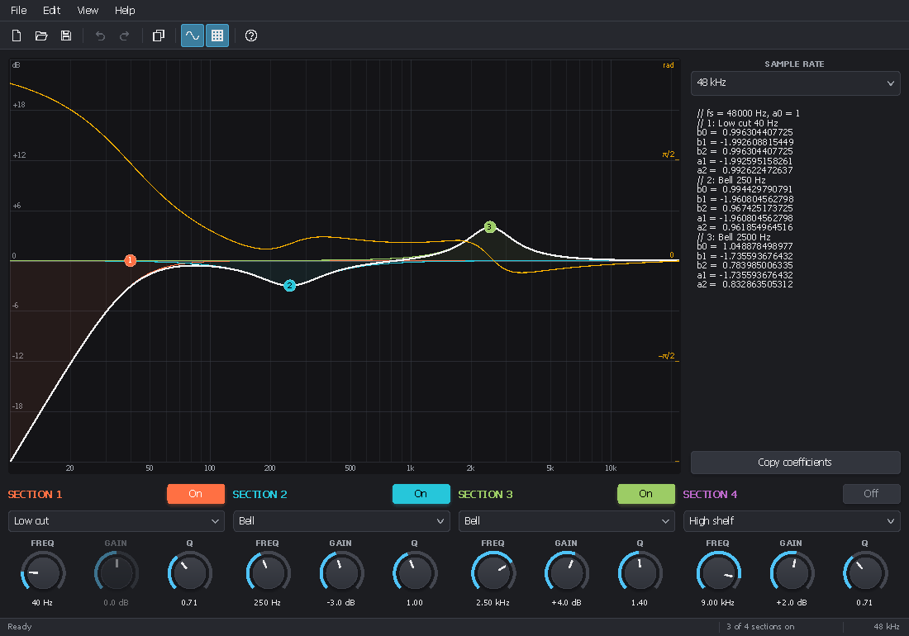

<!-- 2026/11/05 15:08:00 UTC - PluginUI -->

# Biquad Designer — PluginUI desktop demo

[Version française](README_FR.md)

A complete Windows desktop application whose whole interface is PluginUI, built with
[PluginUI.Desktop](../../docs/DESKTOP.md). It designs a cascade of four RBJ biquad filters and gives their coefficients.
The same code runs as IL (`dotnet run`, debugger) or as one NativeAOT executable.



## What it shows

| Feature | Where |
|---|---|
| Menu bar with mnemonics, Alt / F10, shortcuts, check marks, sub-menus | `DesignerWindow` (`MenuBar`, `Command`, `KeyGesture`) |
| Tool bar sharing the menu commands, status bar with hints, section count, sample rate and messages | `ToolBar`, `StatusBar` |
| New / Open / Save / Save As, "save changes?" when closing, title "Name* — Biquad Designer" | `DocumentSession` |
| Undo / redo of every edit: knob drags, dragged points, menus | `UndoStack.Track`, `UndoStack.Do` |
| Recent files sub-menu, files dropped on the window, file on the command line | `RecentFiles`, `UIHost.FilesDropped` |
| Settings saved in JSON without reflection (View menu, language) | `AppSettings<DemoSettings>`, `DemoJson` |
| Window position and size restored at start, dark or light title bar, icon | `DesktopApplication`, `StandaloneWindow` |
| Synchronous message box and About box drawn by PluginUI | `MessageDialog`, `AboutBox` |

## Using it

- Drag the numbered points of the graph: frequency horizontally, gain vertically; the wheel changes Q.
- Each column sets one section: enable, type (bell, shelves, cuts, notch, band pass), frequency, gain, Q.
- The panel on the right lists `b0 b1 b2 a1 a2` (a0 = 1) of the enabled sections at the chosen sample rate; *Copy
  coefficients* (Ctrl+Shift+C) puts them on the clipboard.
- View: phase curve (Ctrl+P), section curves (Ctrl+B), light theme (Ctrl+T), language (applies at the next start).

| Shortcut | Action |
|---|---|
| Ctrl+N, Ctrl+O, Ctrl+S, Ctrl+Shift+S | New, Open, Save, Save As |
| Ctrl+Z, Ctrl+Y (or Ctrl+Shift+Z) | Undo, Redo |
| Alt+letter, Alt, F10 | Menus from the keyboard |
| F1 | About |

Files are JSON (`.bqd`), format `pluginui-biquad-1`. Settings and state live in `%APPDATA%\asm8086\Biquad Designer`.

## Building

```
dotnet run --project samples/PluginUI.DesktopDemo                                         # IL, debuggable
dotnet run --project samples/PluginUI.DesktopDemo -- --lang fr                            # French interface
dotnet publish samples/PluginUI.DesktopDemo -c Release -r win-x64 -p:PublishAot=true      # NativeAOT, one .exe
dotnet publish samples/PluginUI.DesktopDemo -c Release -r win-x64 -p:SelfContained=true   # IL with the runtime
dotnet run --project samples/PluginUI.DesktopDemo -- --snapshot out 2                     # PNG captures (docs)
```

`Main` carries `[STAThread]`: the file dialogs, the clipboard and drag and drop need a single-threaded apartment.
