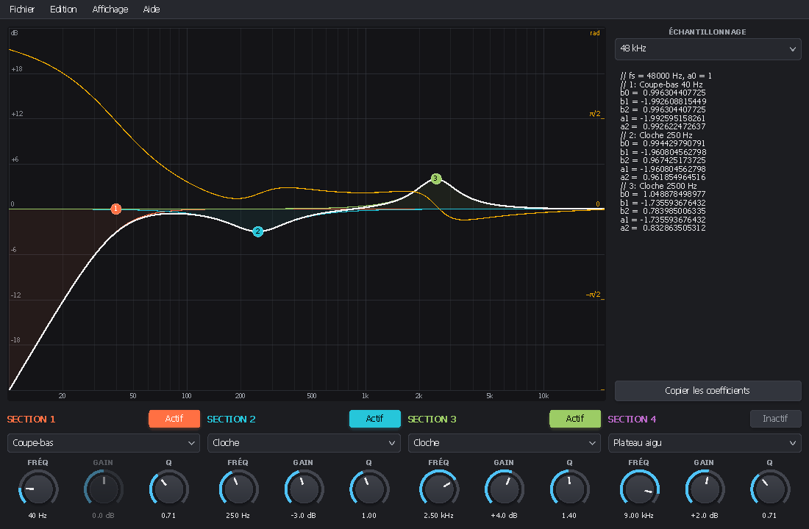

<!-- 2026/11/05 14:06:00 UTC - PluginUI -->

# Biquad Designer — démonstration bureau de PluginUI

[English version](README.md)

Une application de bureau Windows complète dont toute l'interface est PluginUI, construite avec
[PluginUI.Desktop](../../docs/DESKTOP_FR.md). Elle conçoit une cascade de quatre filtres biquad RBJ et donne leurs
coefficients. Le même code fonctionne en IL (`dotnet run`, débogueur) ou en un seul exécutable NativeAOT.



## Ce qu'elle montre

| Fonction | Où |
|---|---|
| Barre de menus avec lettres soulignées, Alt / F10, raccourcis, coches, sous-menus | `DesignerWindow` (`MenuBar`, `Command`, `KeyGesture`) |
| Nouveau / Ouvrir / Enregistrer / Enregistrer sous, « enregistrer les modifications ? » à la fermeture, titre « Nom* — Biquad Designer » | `DocumentSession` |
| Annulation de chaque modification : boutons rotatifs, points glissés, menus | `UndoStack.Track`, `UndoStack.Do` |
| Sous-menu des fichiers récents, fichiers déposés sur la fenêtre, fichier en ligne de commande | `RecentFiles`, `UIHost.FilesDropped` |
| Réglages enregistrés en JSON sans réflexion (menu Affichage, langue) | `AppSettings<DemoSettings>`, `DemoJson` |
| Position et taille de la fenêtre restaurées au démarrage, barre de titre sombre ou claire, icône | `DesktopApplication`, `StandaloneWindow` |
| Boîte de message synchrone et boîte À propos dessinées par PluginUI | `MessageDialog`, `AboutBox` |

## Utilisation

- Faites glisser les points numérotés du graphique : la fréquence horizontalement, le gain verticalement ; la molette
  change Q.
- Chaque colonne règle une section : activation, type (cloche, plateaux, coupe-bas / haut, réjection, passe-bande),
  fréquence, gain, Q.
- Le panneau de droite liste `b0 b1 b2 a1 a2` (a0 = 1) des sections actives à la fréquence d'échantillonnage choisie ;
  *Copier les coefficients* (Ctrl+Maj+C) les place dans le presse-papiers.
- Affichage : courbe de phase (Ctrl+P), courbes des sections (Ctrl+B), thème clair (Ctrl+T), langue (appliquée au
  prochain démarrage).

| Raccourci | Action |
|---|---|
| Ctrl+N, Ctrl+O, Ctrl+S, Ctrl+Maj+S | Nouveau, Ouvrir, Enregistrer, Enregistrer sous |
| Ctrl+Z, Ctrl+Y (ou Ctrl+Maj+Z) | Annuler, Rétablir |
| Alt+lettre, Alt, F10 | Menus au clavier |
| F1 | À propos |

Les fichiers sont en JSON (`.bqd`), format `pluginui-biquad-1`. Réglages et état sont dans
`%APPDATA%\asm8086\Biquad Designer`.

## Compilation

```
dotnet run --project samples/PluginUI.DesktopDemo                                         # IL, débogable
dotnet run --project samples/PluginUI.DesktopDemo -- --lang fr                            # interface en français
dotnet publish samples/PluginUI.DesktopDemo -c Release -r win-x64 -p:PublishAot=true      # NativeAOT, un seul .exe
dotnet publish samples/PluginUI.DesktopDemo -c Release -r win-x64 -p:SelfContained=true   # IL avec le runtime
dotnet run --project samples/PluginUI.DesktopDemo -- --snapshot out 2                     # captures PNG (docs)
```

`Main` porte `[STAThread]` : les dialogues de fichiers, le presse-papiers et le glisser-déposer exigent un
cloisonnement monothread (STA).
